# SimeGuardian

**Making sure someone notices when an elderly resident’s day goes quiet.**

An opt-in wellbeing check for Sime Darby Property township residents who are often home alone. SimeGuardian uses household activity signals to notice an unusual silence, asks the resident first, then brings in family and township responders if nobody replies.

Built for the **Sime Darby Property University Hackathon 2026 · Township of Tomorrow · Theme 1: People, Community Wellbeing**.

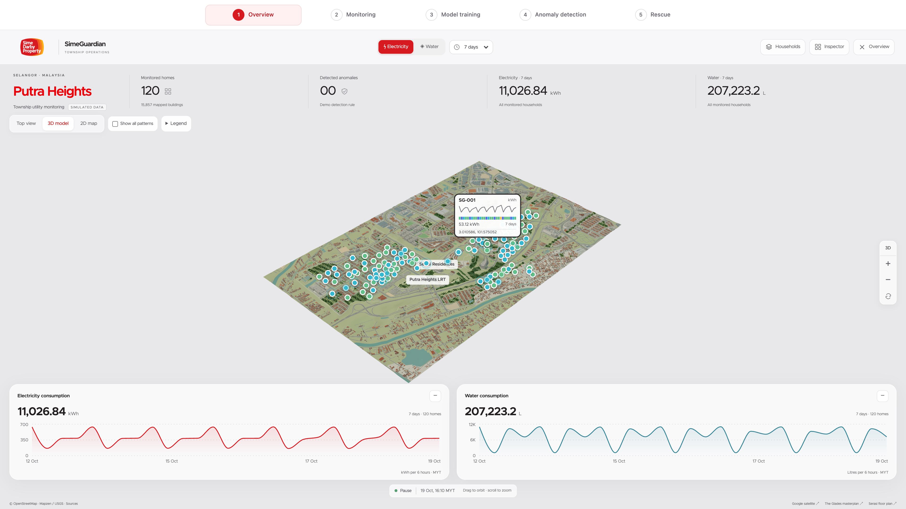

*Real map geography; simulated household identities, readings and alerts. All prototype data is synthetic.*

[Solution](#3-our-solution) · [How it works](#5-how-it-works) · [Prototype](#11-visual-concept--working-prototype) · [Run locally](#run-locally) · [Research](#research-and-experiment-history)

The product story below follows the [hackathon slide deck](Sime_Darby_Hackathon_Slides%20%281%29.pptx). Setup instructions and research notes follow it.

## Team

**Comeback Duo · Universiti Malaya**

| Member | Role |
| --- | --- |
| Lim Jiale | Team leader |
| Tan Hao Wen | Team member |
| Tan Zhi Hong | Team member |

## 1. The problem

When an older resident lives alone and their usual routine stops, family may be too far away to notice. Township security is nearby, but needs a clear reason and an agreed process to check in.

SimeGuardian connects that quiet period to a human response, while keeping the resident in control.

## 2. Target users

| Person | Situation | What they need |
| --- | --- | --- |
| **Madam Lee, 72** | Lives alone; her children work far away | A simple check-in, with her consent |
| **Daniel, 41** | Her son, working 25 km away in Kuala Lumpur | An alert when a response is needed |
| **Township responder** | On site, with no existing wellbeing trigger | One assigned incident and a clear outcome to record |

*These are demo personas. Joining is voluntary and requires no health diagnosis.*

## 3. Our solution

**A check-in first. Then a human.**

1. **Notice:** compare household activity with the home’s normal routine and check home/away context.
2. **Ask the resident:** show an **“Are you OK?”** prompt with an **“I’m OK”** action.
3. **Escalate until answered:** contact family after **5 unanswered minutes**, then request a township welfare check after **10 unanswered minutes** in total.
4. **Close the loop:** record the human outcome in the incident timeline.

<table>
  <tr>
    <th>Resident · asked first</th>
    <th>Family · alerted after 5 minutes</th>
    <th>Resolved · family sees the outcome</th>
  </tr>
  <tr>
    <td>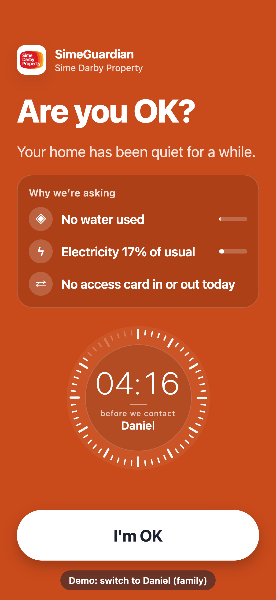</td>
    <td>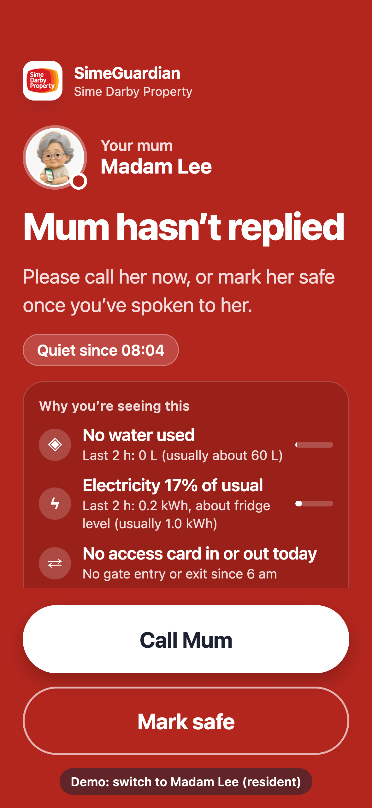</td>
    <td>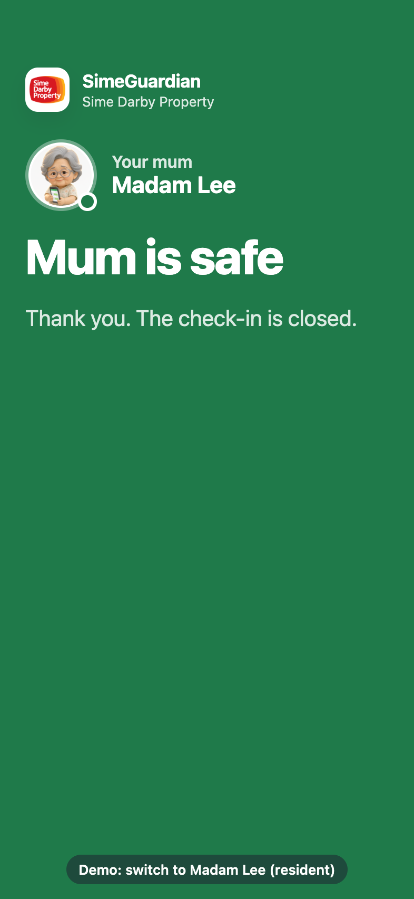</td>
  </tr>
</table>

*Expo screens captured in a browser at iPhone dimensions; these are not native iOS notification captures.*

## 4. Innovation

| Principle | What it adds |
| --- | --- |
| **Township coordination** | Connects activity evidence to family and an on-site responder |
| **Multiple signals** | Uses utility patterns with movement/app context, rather than treating one quiet feed as an emergency |
| **Resident first** | Gives the resident a chance to answer before escalating |
| **Explainable alerts** | Shows the triggering evidence, model/policy decision and response history |
| **Measured model selection** | Compares rules and learned models; MLflow candidates require explicit, quality-gated promotion |

The proposed service reuses available township data feeds. Real utility and access-system integrations remain pilot work; the prototype simulates them.

## 5. How it works

| Stage | Behaviour |
| --- | --- |
| **Signals in** | Electricity, water, parking/car plate, gate access, mall visits and app activity are the proposed source groups |
| **Learn and detect** | A 14-day baseline supports the rule/model approach described in the deck |
| **Check in and escalate** | Resident → family at +5 min → township at +10 min |
| **Resolve and record** | One incident timeline records responsibility and the completed human check-in |

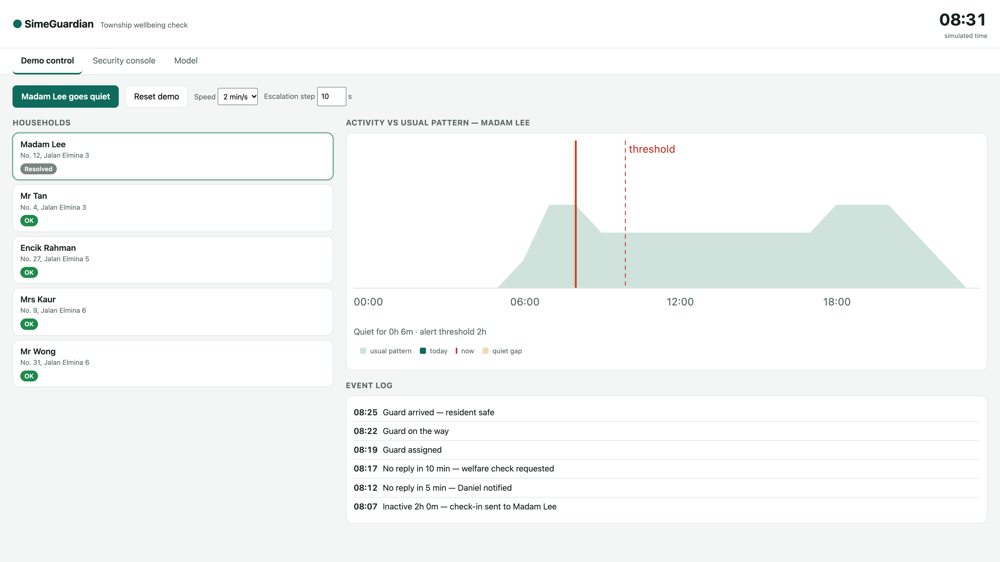

*The phone demo compresses each five-minute escalation interval to 10 seconds by default. The event log displays simulated elapsed time.*

Detection safeguards demonstrated in the deck include away mode, missing/stale data, conflicting resident activity and duplicate-incident suppression. Missing readings must remain missing rather than being treated as zero. The documented rule requires both electricity and water below 20% of the home’s baseline for 60 minutes; one low utility alone is insufficient.

## 6. Technical architecture

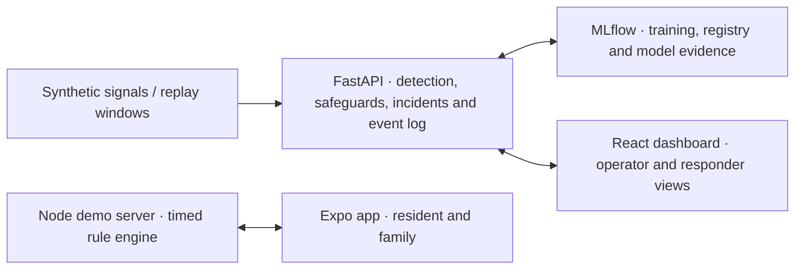

| Component | Location | Current responsibility |
| --- | --- | --- |
| Resident and family app | [`app/`](app/) | Expo / React Native consent, check-in and family screens |
| Phone demo server | [`server/`](server/) | Timed escalation, demo controls and security console on port 4000 |
| Operator dashboard | [`web/`](web/) | React / TypeScript township map, monitoring, training and response views |
| Backend | [`backend/`](backend/) | FastAPI replay inference, persisted incidents, scoped sessions and MLflow controls |
| Detection experiments | [`ml/`](ml/) | Synthetic datasets, rule/model comparisons and household studies |

**Integration boundary:** the Expo app uses the Node demo server. The React/FastAPI dashboard is a separate local workflow. Its six-source explorer is an illustrative fixture, separate from registered-model replay inputs; its notifications are simulated. Native phone delivery from FastAPI and a complete causal source-ingestion pipeline remain planned. See [dashboard boundaries](docs/DASHBOARD.md) and [MLflow integration](docs/MLFLOW.md).

## 7. Privacy and consent

The proposed service lets residents opt in, choose their family contacts, pause with away mode and withdraw. The deck proposes completing withdrawal within 23 hours; the full withdrawal workflow remains planned.

| Proposed data use | Excluded from the proposed service |
| --- | --- |
| Consented utility readings | Video and audio |
| Gate and car-plate events | Health records |
| Minimal mall-visit events and app activity | Mood or loneliness inference |

Responders should see only the information needed for their assigned check-in. The local FastAPI demo enforces separate operator/responder scopes, but selectable demo identities are not production account authentication. Real-data use requires the proposed PDPA legal review and consent process.

<details>
<summary>View the resident’s consent and home screens</summary>

<p>
  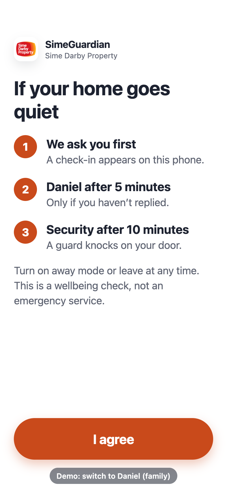
  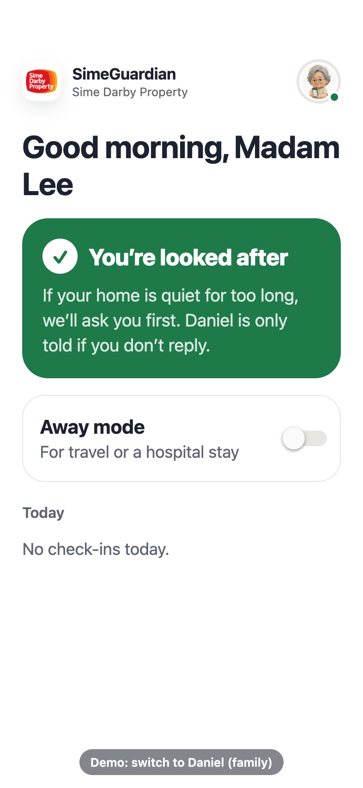
</p>

</details>

## 8. Impact

These are **proposed pilot targets**, not measured service outcomes.

| Measure | Target |
| --- | --- |
| False alarms | ≤ 1 per home per month |
| Family alert to human check-in | < 30 minutes |
| Township welfare check during drills | < 15 minutes |
| Families reporting greater confidence | ≥ 80% |

## 9. Feasibility

The proposed pilot covers **30–50 opt-in households in one guarded precinct over approximately three months**. It aims to reuse existing data feeds without installing new hardware, subject to feed availability and permissions.

The deck identifies **Sime Darby Property, TNB, Air Selangor and the JMB** as prospective partners. Data access, funding, operational commitments and a field pilot remain proposals.

## 10. Implementation plan

| Weeks | Phase | Deliverable |
| --- | --- | --- |
| 1–3 | Setup | Consent, data feeds and responder roster |
| 4–5 | Shadow mode | Review alerts without sending them |
| 6–9 | Response drills | Practise resident → family → township escalation |
| 10–12 | Live service | Run approved alerts and collect family feedback |
| 13 | Review | Report results to SDP and decide whether to proceed |

## 11. Visual concept · working prototype

The prototype includes resident/family screens, timed escalation, a security console, a 3D township dashboard and model-training evidence.

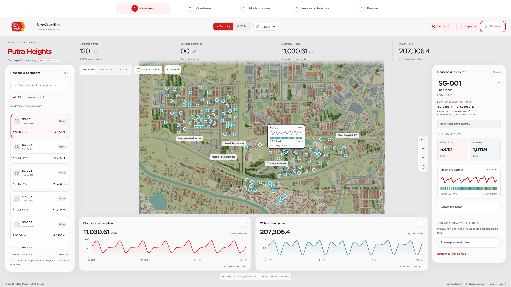

*Putra Heights map with simulated household usage. Map colours show relative usage; they do not establish a medical condition or an emergency.*

<details>
<summary>View the incident, security and model screens</summary>

**Incident evidence and timeline**

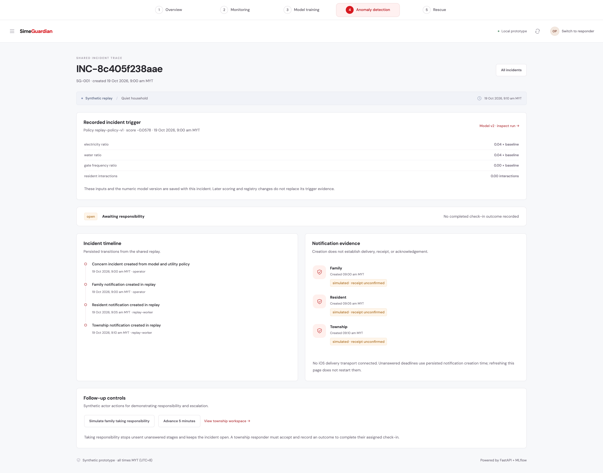

**Township security console**

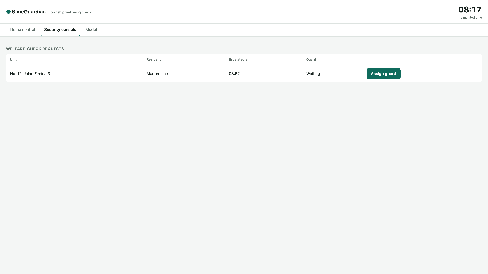

**Rule versus model comparison**

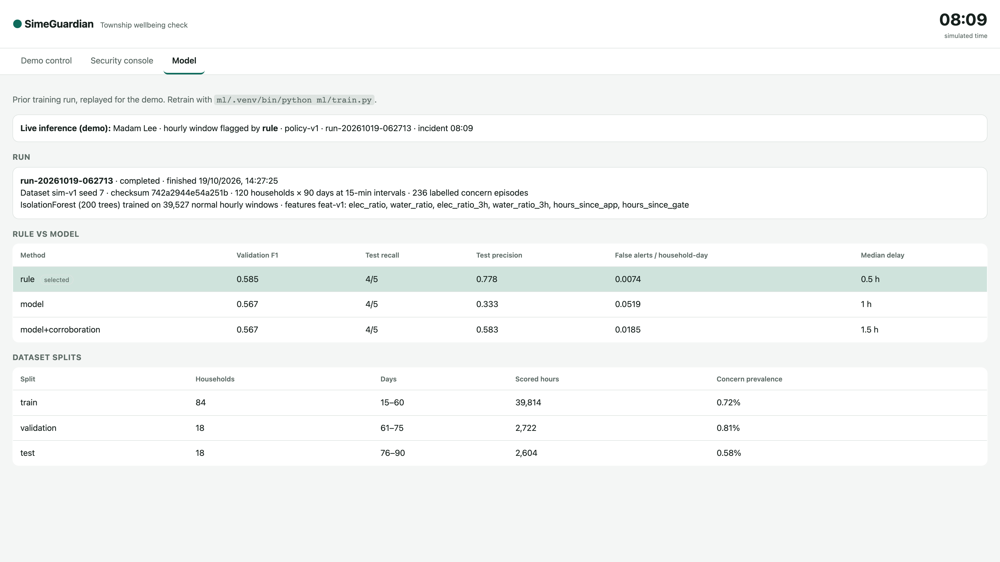

**MLflow model registry**

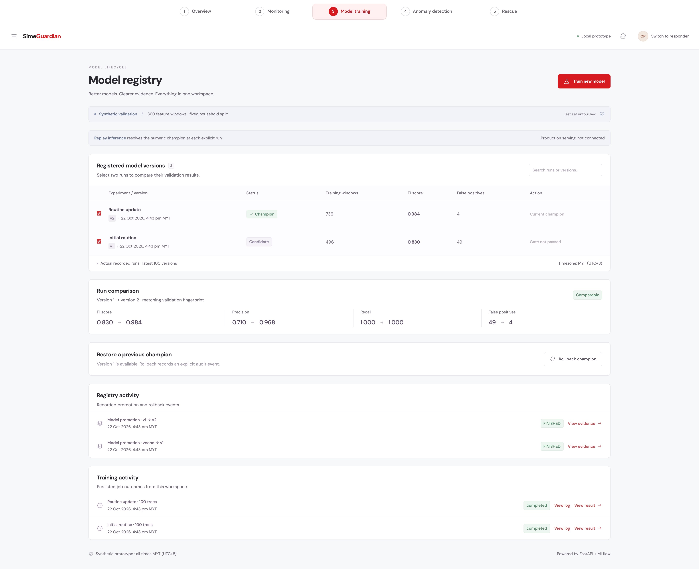

</details>

### Benchmark shown in the presentation

The deck reports the following **synthetic held-out test results: 18 households and 5 episodes**. The policy was selected on validation F1. These historical benchmark results are separate from the FastAPI MLflow fixture and the later household studies.

| Method | Alert precision | Episode recall | False alerts / household-day |
| --- | --- | --- | --- |
| Rule baseline | 0.78 | 0.80 | 0.007 |
| Isolation Forest | 0.33 | 0.80 | 0.052 |
| Isolation Forest + corroboration | 0.58 | 0.80 | 0.019 |

The rule performs best in this presentation benchmark. These scores are not clinical sensitivity or evidence of field performance. Previous local results for the legacy server’s **Model** tab were removed; a fresh run is needed to populate that tab.

## 12. Why SimeGuardian

SimeGuardian gives a township a clear path from an unusual silence to a completed human check-in. The resident answers first, family comes next, and an on-site responder has an assigned task if the silence continues. The next proposed step is a consented pilot with 30–50 households in one SDP precinct.

## Run locally

There are two local demo workflows: the phone escalation demo and the React/FastAPI dashboard.

### Resident and family phone demo

Use **Node 24**, **Expo Go** on an iPhone, and a shared Wi-Fi network or phone hotspot.

From the repository root, start the demo server:

```bash
cd server
npm start
```

Open <http://localhost:4000> for **Demo control**, **Security console** and the legacy **Model** tab. In another terminal, from the repository root:

```bash
cd app
npm install
npx expo start
```

Scan the QR code with the iPhone Camera to open Expo Go. For presenting, use iPhone Mirroring, or QuickTime → New Movie Recording → iPhone over USB.

If the app cannot reach the server, start Expo with the Mac’s local IP explicitly set:

```bash
EXPO_PUBLIC_SERVER_URL=http://<mac-ip>:4000 npx expo start
```

On Wi-Fi that isolates devices, use the phone’s hotspot, or combine `npx expo start --tunnel` with a server URL reachable by the phone.

| Scenario | Steps |
| --- | --- |
| **Escalation** | Select Madam Lee, complete consent, then click **Madam Lee goes quiet** on Demo control. Leave the check-in unanswered. After 10 seconds, switch to Daniel to see **Call Mum / Mark safe**. After another 10 seconds, use **Assign guard → Mark on the way → Mark arrived** in Security console. Inspect the completed event log. |
| **Resident confirms safety** | Click **Reset demo**, switch back to Madam Lee and repeat onboarding. Trigger the quiet scenario, then tap **I’m OK**. The alert closes across screens. |

The escalation step and clock speed are configurable in Demo control. Activity feeds, the guard and family phone-call scenario are simulated; no live utility or access-system integration is connected.

### Run the main dashboard

Use **Python 3.12**, **uv** and Node/npm. Install dependencies from the repository root:

```bash
cd backend
uv sync --locked
cd ../web
npm ci
```

Return to the repository root and start the development stack:

```bash
make dev
```

This starts the React dashboard at <http://127.0.0.1:5173>, FastAPI at <http://127.0.0.1:8000> and MLflow at <http://127.0.0.1:5050>. Vite proxies `/api` to FastAPI. Ctrl+C stops all three; `make dev-mlflow` starts only tracking.

For FastAPI to serve the built frontend, run `npm run build` in `web/`, keep MLflow running, then start the backend:

```bash
cd backend
MLFLOW_DISABLE_TELEMETRY=true uv run --locked uvicorn app.main:app --host 127.0.0.1 --port 8000
```

Open <http://127.0.0.1:8000>. Follow the [MLflow runbook](docs/MLFLOW.md#run-locally) to create initial training runs when needed. Training creates a candidate; promotion is explicit and quality-gated. The next explicit replay inference resolves the selected numeric champion.

This dashboard is a loopback-only synthetic demo. See the [dashboard walkthrough](docs/DASHBOARD.md#demonstrate-the-journey) for replay, escalation, responder outcomes and implementation boundaries.

## Research and experiment history

The household studies are isolated synthetic experiments. Their datasets, labels, evaluation units and thresholds differ from the presentation benchmark; their scores should not be compared directly.

The latest [precision study (v6)](ml/household/PRECISION_REVIEW.md) reports pooled reviewed-interval precision of **91.0% for utility anomalies and 87.1% for emergencies**, with recall of **61.0% and 22.1%** respectively. Grouped-alert precision is **75.0% and 71.4%**. Two individual emergency replays fall below 85% precision. These are independent simulation replays for one family archetype, not real-world validation.

<details>
<summary>Research commands, earlier studies and legacy training</summary>

### Precision optimisation (v6)

The [precision study](ml/household/PRECISION_REVIEW.md) reaches pooled reviewed-interval precision of **91.0% for utility anomalies and 87.1% for emergencies**, using new reserved simulation replays. Recall is 61.0% and 22.1%; grouped-alert precision remains 75.0% and 71.4%. The simulator is unchanged, the four separate source LSTMs are reused, and only detector training/features/calibration change. Family confirmations remain labels only.

```sh
python3 ml/household/precision_study.py prepare
python3 ml/household/precision_study.py run --device mps
python3 ml/household/verify_precision.py
python3 -m unittest discover -s ml -p 'test_*.py'
```

The CSV data catalog is `ml/household/precision_data_v6/plan.csv`; results are in `ml/household/runs/precision-v6/`. All three reserved test seeds are retained; two individual emergency replays fall below 85% precision. This is one family archetype with independent simulation replicates, not real-world validation or multiple independent households. Commands refuse existing destinations; choose fresh `--data`/`--out` paths for reruns. Use `--device cpu` without MPS.

### Earlier v5: independent forecasts and revised detection

The [v5 study](ml/household/README.md#current-v5-revision) keeps four independent LSTMs for electricity, water, gate and ordinary app activity, followed by separate usage-anomaly and emergency classifiers. The revision addresses sparse/corrupted training labels and makes the older adult's agreed check-in deadlines explicit. Family confirmation responses remain labels only. [Investigation and results](ml/household/DETECTION_REVIEW.md).

```sh
python3 ml/household/multisource_dataset.py generate --revised --data ml/household/multisource_data_v5
python3 ml/household/two_stage.py --data ml/household/multisource_data_v5 --out ml/household/runs/two-stage-v5 --device mps
python3 ml/household/verify_two_stage.py
python3 -m unittest discover -s ml -p 'test_*.py'
```

Generation/training refuses to overwrite existing artifacts: choose fresh paths for a rerun. Review the CSVs in `ml/household/multisource_data_v5/` and `ml/household/runs/two-stage-v5/`. Start with `app_reviews.csv`, `confusion_matrices.csv`, `forecast_metrics.csv`, `oracle_scenario_metrics.csv` and `report.md`. Fixed baseline weights remain 40% electricity, 30% water, 15% gate and 15% app; they do not constrain learned tree importance. Unconfirmed feedback is not counted as normal. Previous versions remain preserved. This enriched synthetic year is not evidence of real-world emergency performance.

### Earlier v3 dataset: electricity-only with family app confirmations

The earlier [v3 dataset](ml/household/README.md#current-study-electricity-anomalies-with-app-confirmed-labels) forecasts one family's electricity use and detects unexpected electricity patterns. **Electricity history and calendar are model inputs; family app confirmations supply labels only.** Water/gate records remain optional context. The target is household electricity usage, not an older adult's medical condition.

```sh
python3 ml/household/electricity_dataset.py generate
python3 ml/household/electricity_dataset.py validate
python3 ml/household/electricity_dataset.py benchmark
```

Review `ml/household/electricity_data_v3/hourly.csv`, `app_reviews.csv` and `app_labels_hourly.csv`. A validation-only benchmark is saved in `ml/household/runs/electricity-v3-validation/`. All reports are simulated, unknown feedback stays unlabelled, and the test period is reserved. No application workflow changes. The earlier family experiments below are preserved separately.

### Earlier family inactivity experiments

A separate [illustrative synthetic benchmark](ml/household/ILLUSTRATIVE_REVIEW.md) deliberately makes emergencies easier to distinguish: daytime-only cases and reliable hourly elder check-ins. It achieves 93.8% reviewed-interval precision and 88.2% recall including positive abstentions, detecting 29/30 episodes; grouped-alert precision is 74.4%. The original difficult data/results are preserved. These new scores describe the changed simulation, not improved real-world reliability.

The latest [research review](ml/household/RECALL_REVIEW.md) prioritises emergency recall and separates it from usage forecasting. A frozen validation-selected threshold raises fresh synthetic emergency recall 27.0% → 87.8% and reduces FN 84 → 14, while precision falls 88.6% → 28.1%. Entire-episode recall is 28/30, but false alert groups reach 51.6 per 30 household-days. A development-only investigation demonstrates why identical sleep/emergency inputs need additional timely resident-specific evidence. Source-only LSTMs remain separate; no application notification behaviour changed.

The research work has restarted with [one family household](ml/household/README.md): an older adult, two other adults and two children. It generates one year of resident routines, electricity and water readings, attributable app/gate events, outages and delayed observations. Resident activity and concern labels stay in separate truth tables. CSV outputs include a separate paired scenario suite for older-adult inactivity masked by family activity. Previous research datasets, models and reports have been deleted. A separate trainer now compares seasonal-naive, ridge, random forest, gradient boosting and LSTM on the frozen family dataset.

```bash
python3 ml/household/generate.py
python3 ml/household/validate.py ml/household/data
python3 -m unittest discover -s ml -p 'test_household_dataset.py'
```

Review `ml/household/data/hourly.csv`, `truth/episodes.csv`, `review.md` and `overview.png`. These remain isolated from the app's existing synthetic fixtures. Use NumPy and Matplotlib; exact generator and dependency versions are recorded in the output CSV configuration.

```sh
python3 ml/household/train.py --out ml/household/runs/comparison
python3 ml/household/train.py --models ridge gradient_boosting --seeds 11 --out ml/household/runs/selected
```

See the [training instructions and tested dependencies](ml/household/README.md#train-different-algorithms). Each run saves CSV predictions/metrics, fitted models and a report, without modifying the dataset. All learned models use matching 14-day histories and chronological splits; exploratory inactivity alarms are evaluated separately from forecast accuracy. This remains a synthetic, one-family study with only two concern episodes in the main test period.

The [paper's breakfast, lunch and sleep alarm rules](ml/household/README.md#use-the-papers-activity-alarm-rules) can also be replayed against a completed forecasting run:

```sh
python3 ml/household/paper_alarms.py --run ml/household/runs/comparison --out ml/household/runs/paper-alarms
```

The [v2 evaluation](ml/household/README.md#evaluation-v2-availability-separate-labels-and-hourly-detection) adds a separate frozen CSV challenge with household routine labels and elder-concern labels, a fixed 30-minute upload allowance, and an hourly elder-focused Isolation Forest comparison. Run `python3 ml/household/evaluation_v2.py prepare` followed by `python3 ml/household/evaluation_v2.py run --device mps`. The original year and saved forecasts remain unchanged; the previously reviewed test is development evidence, while the new challenge is scored after its plan is frozen.

This implements the paper's alarm stage with documented timing and standard-deviation assumptions; it reuses the existing forecasters. Household routine alarms and elder-concern results are reported separately.

### Legacy app demo training

`ml/` generates a synthetic dataset (120 elderly households × 90 days of 15-minute electricity and water, plus app and gate events, with labelled concern episodes, naps, away trips and feed outages), builds past-only hourly features, splits households 70/15/15 with separate date ranges, trains an Isolation Forest on normal training windows, picks thresholds on validation and scores the untouched test split once against the rule baseline.

```bash
python3 -m venv ml/.venv && ml/.venv/bin/pip install -r ml/requirements.txt
ml/.venv/bin/python ml/train.py     # writes ml/runs/<run_id>/ and ml/runs/latest.json
```

This older Isolation Forest demo pipeline is retained for its existing app callers. It is not the new family dataset or a result of the restarted study.

</details>

## Checks

Run commands from the indicated directory:

| Scope | Directory | Command |
| --- | --- | --- |
| Phone demo server | `server/` | `npm test` |
| App timeout handling | Repository root | `node --test app/src/timeout.test.ts` |
| FastAPI / MLflow backend | `backend/` | `uv run --locked pytest -q` |
| Dashboard build | `web/` | `npm run build` |
| ML experiments | Repository root | `ml/.venv/bin/python -m unittest discover ml` |
| Dashboard browser checks | `web/` | `npm run test:e2e` |

Browser checks require the local services, installed Google Chrome and initial/retrained model versions. They append a synthetic candidate, temporarily roll back/restore the champion and reset the current replay while retaining MLflow evidence.

## Documentation

- [Business and product requirements](docs/REQUIREMENTS.md)
- [Design](docs/DESIGN.md)
- [Dashboard walkthrough and implementation boundaries](docs/DASHBOARD.md)
- [MLflow setup, model evolution and integration](docs/MLFLOW.md)
- [Web dashboard implementation plan](docs/IMPLEMENTATION_PLAN.md)
- [Mobile implementation plan](docs/MOBILE_IMPLEMENTATION_PLAN.md) — originally written for native/Flutter clients; this branch uses Expo Go
- [Phone demo design](docs/superpowers/specs/2026-10-19-simeguardian-demo-design.md) and [implementation plan](docs/superpowers/plans/2026-10-19-simeguardian-demo.md)
- [Map sources, attribution and extraction](web/public/township/SOURCES.md)
- [Screenshot catalog](docs/images/simeguardian/README.md)
- [Hackathon presentation](Sime_Darby_Hackathon_Slides%20%281%29.pptx)
