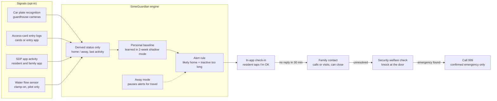

# SimeGuardian — Business Requirements Document

Oct 18, 2026 · Tan Hao Wen

## Executive summary

SimeGuardian is an opt-in wellbeing check for SDP residents who are often home alone. It flags when a resident may be down at home and escalates until a person confirms they are safe.

- **Focus area:** People, covering Safety and security, Community wellbeing, and Accessibility and inclusion. Water leak detection is a secondary Planet benefit in phase 2.
- **How it works:** SDP-controlled signals (car plate recognition, access cards, SDP app activity) establish whether a resident is home or away. Signs of activity inside the home (water use in the pilot, utility data later) show whether there has been recent activity. A prolonged unexplained silence triggers an in-app check-in. No response within 30 minutes escalates to family, then security.
- **Who it serves:** The primary user is an older resident who is home alone during the day. The buyer is usually a working adult child. Expansion segments are people living alone and residents managing long-term conditions.
- **Why SDP:** It reuses infrastructure SDP townships already run. It gives residents a reason to engage with the SDP app after handover, and supports ageing in place, which keeps families in SDP townships.
- **Pilot:** 3 months, one precinct, 30–50 opt-in households, measured on false-alarm rate, check-in resolution time, welfare-check response time and family confidence.
- **Novelty:** Utility-based elderly monitoring is established overseas (for example Japan's *mimamori* services). Adapting it to Malaysian townships, with fused township signals, is new locally.

| Item | Detail |
| --- | --- |
| Programme | Sime Darby Property University Hackathon 2026, Township of Tomorrow |
| Document | Business Requirements Document, v0.1 draft |
| Proposal deadline | 23 October 2026, 11:59 p.m. |
| Status | Draft for team review; figures marked "to confirm" need validation |

## Problem statement and objectives

More SDP residents now spend long stretches at home with no one around, and nothing in the township notices when their normal activity stops.

A resident who falls or collapses at home may not be found for hours or days. Today that depends on a family member happening to call or a neighbour noticing something is wrong. Wearable panic buttons help only if the person is wearing one, has charged it, and is conscious enough to press it.

**Business objectives**

1. Detect a prolonged, unexplained lack of activity in an opted-in home and get a human to confirm the resident is safe.
2. Keep false alarms low enough that families and security teams trust the alerts.
3. Use infrastructure SDP townships already have, with no wearable and no camera inside the home.
4. Give residents a reason to keep using the SDP app after handover, and give SDP a measurable social-impact outcome.

**Success at the end of the pilot** means a false-alarm rate per household per month and a median check-in resolution time that both meet the targets in the Impact and KPIs section, together with a positive family-confidence score.

## Demand evidence and data sources

The number of older Malaysians living alone roughly tripled between 2018 and 2025. Over the same period, working-age household members are more likely to be at work all day.

| Indicator | Figure | Why it matters | Source |
| --- | --- | --- | --- |
| Older persons (60+) living alone | 18.8% (about 770,800) in 2025, up from 6.3% in 2018 | Core target group, and growing fast | [NHMS 2025 via Bernama](https://www.bernama.com/en/bfokus/news.php?id=2618795) |
| Estimated people dying alone at home | About 3,500 cases a year (expert estimate) | Shows the harm of no one noticing | [Bernama, Oct 2026](https://www.bernama.com/en/bfokus/news.php?id=2618795) |
| Falls among people aged 60+ | 14.3% in 2025 (14.1% in 2018); living alone more than doubles fall risk | Falls are the main "down at home" event | [CodeBlue, NHMS 2025](https://codeblue.galencentre.org/2026/04/only-15-of-malaysian-seniors-ageing-well-dementia-rate-up-nhms-2025/); [Bernama](https://www.bernama.com/en/bfokus/news.php?id=2618795) |
| Seniors with 2 or more chronic diseases | About 68%; dementia 9.8% | Higher risk of sudden incidents | [CodeBlue, NHMS 2025](https://codeblue.galencentre.org/2026/04/only-15-of-malaysian-seniors-ageing-well-dementia-rate-up-nhms-2025/) |
| Population aged 65+ | 8.0% in 2025, up from 7.6% in 2024 | The ageing trend is steady | [DOSM, Current Population Estimates 2025](https://www.dosm.gov.my/portal-main/release-content/current-population-estimates-2025) |
| Ageing-nation threshold (60+ above 15%) | Projected around 2030 by DOSM; 2036 under the National Policy for Older Persons | Demand keeps rising through the rollout period | [Malay Mail, DOSM 2024](https://www.malaymail.com/news/malaysia/2024/07/31/malaysia-set-to-become-ageing-nation-by-2030-perak-leads-senior-surge-dosm-report-says/145577); [The Edge](https://theedgemalaysia.com/node/762293) |
| Selangor and KL ageing outlook | Projected "super-aged" (65+ above 20%) by 2060 | SDP's core townships are in Selangor | [The Edge](https://theedgemalaysia.com/node/762293) |
| Household size and earners | 3.7 persons with 1.8 income earners per household (2024) | Most households have more than one earner, so homes are empty during work hours | [DOSM, HIS 2024](https://www.dosm.gov.my/portal-main/release-content/household-income-survey-report--malaysia--states-2024) |
| Women in the labour force | 56.6% nationally (record high), 70.7% in Selangor (2025) | Fewer family members at home during the day | [The Sun, DOSM 2025](https://thesun.my/news/malaysia-news/people-issues/putrajaya-leads-malaysia-in-women-labour-force-participation) |
| Adults with diabetes / hypertension | 15.6% / 29.2% (2023) | Expansion segment: people managing long-term conditions | [NHMS 2023 fact sheet](https://iku.moh.gov.my/images/nhms2023/fact-sheet-nhms-2023.pdf) |
| Elderly monitoring device sales | *Team to add the figures and source already gathered* | Shows families already pay for monitoring | *Team source* |

**What the data does not show yet.** These are national or state figures. Judges will ask how many households in a specific SDP township fit the profile. Estimate the pilot township's addressable households as:

*total occupied homes × share of households with a resident aged 60+ × share of those living alone or home alone in the daytime*

Use township-level figures from SDP if they can share them. Otherwise use DOSM district data for the district the township sits in, and label the estimate as such.

**Validation still to collect before 23 October:** a short survey of 15 or more adult children with a parent living alone, and 1–2 interviews with a township security or management team.

## Target demographics and personas

The pilot targets one group: residents aged 60 and over who are home alone for long periods. Their working adult children are the people who set the service up and receive the alerts.

| Segment | Who | Role in the service | Phase |
| --- | --- | --- | --- |
| Primary user | Resident aged 60+ who lives alone, or is home alone while family members work | Monitored resident; responds to check-ins | Pilot |
| Buyer and first responder | Adult child or close relative, often in a dual-income household, living elsewhere or out all day | Nominated contact; receives escalations; usually the one who pays | Pilot |
| Expansion: living alone | Adults of any age living alone, such as young professionals and people working from home | Opt-in users with their own nominated contact | Phase 2 |
| Expansion: long-term conditions | Residents managing long-term conditions such as diabetes or heart disease | Opt-in users. Framed strictly as a wellbeing check, never a medical service | Phase 2 |
| Operational users | Township security, guardhouse, or the residents' association or management body | Carry out welfare checks when family can't be reached | Pilot |

**Persona: Madam Lee, 72.** Widowed, lives alone in a terrace house in a guarded SDP precinct. She uses WhatsApp but rarely opens other apps, and won't wear a pendant because it "makes her feel old."

**Persona: Daniel, 41.** Madam Lee's son. He works in KL, his wife also works, and they live 25 km away. He calls his mother most evenings but has no way of knowing she's fine during the day.

**Why the young solo segment waits until phase 2.** Their routines are irregular, which causes more false alarms, and they are the least willing to be monitored. Adding them to the pilot would dilute both the results and the story.

## Scope, solution overview and requirements

The system combines two kinds of signal. **Context signals** show whether the resident is home or away. **Liveness signals** show whether there has been recent activity inside the home. An alert fires only when the resident is likely home and there has been no activity for longer than their own normal pattern.

| Signal | Type | What it tells us | Owner (to confirm) | Phase |
| --- | --- | --- | --- | --- |
| Car plate recognition at guardhouse | Context | Resident's car entered or left | Township security / residents' association | Pilot |
| Access card or app-based entry logs | Context | Resident entered or left on foot | Township security / management body | Pilot |
| SDP app activity | Context and liveness | Resident is active on their phone | SDP | Pilot |
| Clamp-on water flow sensor (opt-in) | Liveness | Taps, toilet or shower used in the last few hours | SDP pilot hardware | Pilot |
| Water utility meter data | Liveness | Same, without new hardware | Air Selangor partnership | Phase 2 |
| Electricity smart meter data | Liveness | Appliance use | TNB partnership | Phase 3 |

TNB smart meters record every 30 minutes but send data to TNB only once a day ([Bernama](https://www.bernama.com/en/news.php?id=1937094)). Utility data alone is therefore too slow for a same-day alert, which is why the pilot uses its own water flow sensor.

### Escalation flow

1. Resident is likely home and inactive beyond their personal threshold.
2. Push notification and in-app check-in. The resident taps "I'm OK" within 30 minutes and the alert closes.
3. No response: the nominated family contact is notified, can call the resident, and can close the alert.
4. No resolution within the agreed window: a guardhouse or security welfare check at the door.
5. Confirmed emergency: the responder calls 999. The service is a check, not an emergency service.

### In scope (pilot)

- Opt-in enrolment, with consent given by the resident themselves
- A personal activity baseline per household, learned over the first 2 weeks
- An "away mode" for travel or hospital stays
- A family dashboard showing status only (OK, check-in pending, escalated), never raw logs
- A security console listing welfare-check requests

### Out of scope

- Cameras or audio inside the home
- Medical diagnosis or health monitoring claims
- Direct dispatch of ambulance or police
- Non-SDP townships

### Functional requirements

| ID | Requirement | Priority |
| --- | --- | --- |
| FR-1 | Resident enrols and gives consent in the SDP app; family member can be added as a delegate | Must |
| FR-2 | System builds a per-household baseline of typical active hours | Must |
| FR-3 | Each signal source sends only a derived status (home/away, last activity time), never raw records | Must |
| FR-4 | Alert rule triggers when likely-home and no activity exceeds the baseline gap | Must |
| FR-5 | 30-minute in-app check-in, then escalation to family, then security | Must |
| FR-6 | Away mode and quiet hours set by resident or delegate | Must |
| FR-7 | Every alert and its outcome is logged for KPI reporting | Must |
| FR-8 | Leak warning when water flow is continuous for an unusual length of time | Should |
| FR-9 | Weekly "all quiet" summary to the family | Could |

### Non-functional requirements

- **Latency:** an inactivity alert within 15 minutes of the threshold being crossed.
- **Availability:** signal ingestion 99.5% or better during the pilot. A sensor going silent raises a device-health alert, not a safety alert.
- **Privacy:** data minimisation, encryption in transit and at rest, and withdrawal of consent takes effect within 24 hours.
- **Accessibility:** large-button check-in, Bahasa Malaysia, English and Chinese interfaces, and an optional voice-call check-in for residents who don't use apps.

## High-level implementation and architecture

Four opt-in signals feed one engine. The engine keeps only derived status, compares it with the household's own baseline, and starts the escalation chain.

Each signal source connects through a small adapter that turns raw events into a status such as "home since 18:02" or "last water use 11:40". Raw logs stay with the source operator.

| Layer | Pilot implementation | Later |
| --- | --- | --- |
| Signal adapters | Scheduled exports or webhooks from the guardhouse system; event stream from the app; MQTT from water sensors | Air Selangor / TNB consented data feeds |
| Engine | Rules plus per-household baseline (time-of-day activity profile) on a managed cloud service | Learned anomaly model once enough data exists |
| Notifications | Push notification in the SDP app; SMS or voice call as fallback | WhatsApp Business messages |
| Consoles | Family status view in the app; web console for the security team | Township operations dashboard |
| Data | Status events only, short retention; audit log of every alert | Same |

**Hackathon prototype (23 October):** a simulator generates a week of signals for several households. One scripted resident goes quiet, and the demo shows the check-in, family escalation and security console end to end.

## Parties involved and responsibilities

SDP owns the platform and the resident relationship. The family is the first responder, and township security is the backstop.

| Party | Responsibility | What they get | Status |
| --- | --- | --- | --- |
| Sime Darby Property | Platform owner; runs the app module; data controller; funds the pilot | Post-handover engagement, sales differentiation, ESG metric | Hackathon sponsor |
| Resident (monitored) | Gives consent; sets away mode; answers check-ins | Safety net without wearing anything | Pilot recruits |
| Family contact | Receives escalations; first to call or visit; usually pays after the pilot | Peace of mind during work hours | Pilot recruits |
| Township security / guardhouse contractor | Welfare check at the door when family can't be reached; shares derived entry/exit status | Clear protocol instead of ad hoc requests | To confirm per township |
| Residents' association or management body (JMB/MC) | Approves data sharing from guardhouse systems they operate after handover | A visible safety service for members | To confirm per township |
| Hardware vendor | Supplies and maintains clamp-on water flow sensors | Pilot contract | To select |
| Air Selangor | Phase 2: consented interval meter data | Customer-care and leak-reduction story | Not yet approached |
| TNB | Phase 3: consented electricity usage data | Same | Not yet approached |
| Hackathon team | Prototype, pilot design, evaluation | Pilot role through SDP intern pathway | Active |

**Key dependency:** car plate and access-card systems in older precincts may be operated by a residents' association or management body after handover, not by SDP. Each pilot precinct needs a written data-sharing agreement with whoever operates them.

## Pilot plan

The pilot runs for 3 months in one guarded SDP precinct, with 30–50 opt-in households. It moves to township-wide rollout only if the gate criteria below are met.

**Precinct selection criteria:** an established precinct, likely to have more older residents (for example in Ara Damansara, Bukit Jelutong or Putra Heights, subject to SDP data); an operating car plate or access-card system; and a security operator willing to run welfare checks.

| Phase | Duration | Activities | Exit criteria |
| --- | --- | --- | --- |
| 0. Setup | Weeks 1–3 | Data-sharing agreement with security operator; recruit households through the SDP app, community events and a residents' association briefing; install water flow sensors | 30 or more households consented, sensors installed |
| 1. Shadow mode | Weeks 4–5 | Signals collected and baselines learned; alerts are generated but **not sent**, and the team reviews each one | False-alarm rate estimated; thresholds tuned |
| 2. Live with family | Weeks 6–9 | Check-ins and family escalation switched on; security welfare checks run as monthly drills only | Check-in resolution time measured |
| 3. Full escalation | Weeks 10–12 | Security welfare checks live; end-of-pilot survey of residents and families | All KPIs measured |
| Decision | Week 13 | Report to SDP: expand, adjust or stop | Gate criteria below |

**Gate to expand:**

- No more than 1 false alarm per household per month reaching the family
- Median check-in resolution under 30 minutes
- At least 80% of families say they feel more confident
- At least 70% of households stay enrolled to the end

**Why drills matter.** Real emergencies are rare. A 50-household pilot may see none in 3 months. Scheduled drills, where the resident deliberately ignores a check-in, are how welfare-check response time gets measured.

**Water track.** The clamp-on sensors give water data during the pilot. In parallel, SDP approaches Air Selangor about consented interval meter data, so that phase 2 can drop the extra hardware.

## Business value for SDP

The main value is township value: residents can age in place safely, families stay in SDP townships, and the SDP app becomes useful after handover. Revenue only needs to cover running costs.

| Value | How SimeGuardian delivers it | How it would be measured |
| --- | --- | --- |
| Ageing in place and retention | Older residents stay in their homes longer; their families have a reason to buy nearby | Resident tenure; enquiries from buyers citing the service |
| Sales differentiation | An "age-ready township" feature for new launches and multigenerational buyers | Launch take-up; marketing-attribution surveys |
| App engagement after handover | Families check status regularly; check-ins create daily touchpoints | Monthly active users of the SDP app in pilot households |
| Reuse of existing assets | Uses guardhouse, access and app infrastructure SDP townships already run | Extra cost per household compared with a standalone device |
| Safer township reputation | Builds on SDP's earlier township safety work, such as the Ara Damansara Safe City initiative ([SDP](https://www.simedarbyproperty.com/node/135)) | Resident safety-perception survey |
| ESG reporting | A measurable social metric: households covered, check-ins resolved, welfare-check response times | Figures added to the sustainability report |
| Reusable platform | The same signal pipeline can later support leak alerts, security and facilities services | Number of services built on it |

**Precedent from the property sector.** In Japan, an elderly-housing specialist (R65) launched a watching service for rental landlords in 2024 using electricity smart meter data, in partnership with a data company backed by power utilities ([Kenbiya](https://www.kenbiya.com/ar/ns/for_rent/citem_service/8271.html)). This shows property companies, not just utilities, can run this kind of service.

**Fit with SDP's stated purpose.** SDP describes real estate as a multiplier of value for people and the planet (briefing p. 9). This feature extends the township's value to residents well after handover.

## Impact and KPIs

The headline impact is time: shortening how long a resident who is down at home goes unnoticed, from hours or days to under an hour.

| KPI | Pilot target | How it's measured |
| --- | --- | --- |
| Time from inactivity threshold to a person confirming the resident is safe | Median under 30 minutes (check-in); under 60 minutes including family | System event log |
| Welfare-check response time (security) | Under 15 minutes from escalation, in drills | Drill log |
| False alarms reaching family | No more than 1 per household per month | Alert log, with the outcome tagged |
| Missed events | 0 in drills | Scheduled drills |
| Enrolment retention | At least 70% at pilot end | Enrolment records |
| Family confidence | At least 80% "more confident" | End-of-pilot survey |
| Resident acceptance | At least 70% "comfortable with the service" | End-of-pilot survey |
| Continuous-flow leak warnings (Planet secondary) | Report count and estimated litres saved | Water sensor data |

**Impact story for judges:**

- **People:** fewer residents lying undiscovered after a fall; families who can work without constant worry; older residents who keep their independence without a wearable.
- **Community:** guardhouse teams with a clear, dignified welfare-check protocol instead of ad hoc requests.
- **Planet (secondary):** the water sensor that detects inactivity also detects continuous flow, catching leaks early.

## Pricing and funding model

The pilot is free. After the pilot, a no-hardware basic tier is included for all residents, and families pay a small monthly fee for the sensor tier. Prices are hypotheses to test in the validation survey.

| Tier | What's included | Proposed price (to validate) | Who pays |
| --- | --- | --- | --- |
| Pilot | All features, including sensor | Free for 3 months | SDP (pilot budget) |
| Basic | Context signals + app check-ins + family escalation; no new hardware | Included for SDP residents | SDP, as an app feature |
| Plus | Basic + water flow sensor + security welfare checks | RM25–35 a month, plus a refundable sensor deposit | Family |
| Township bundle | Plus for all opted-in homes in a precinct | Negotiated, possibly added to maintenance or residents' association fees | Residents' association or management body |

**Price benchmarks.** Overseas, similar services cost about RM20 a month at the low end and over RM100 a month for monitored alarms. These conversions are approximate and depend on exchange rates.

| Comparable service | Published price | Source |
| --- | --- | --- |
| NTT "mimamori" IoT light bulb, Japan | From ¥638 a month | [BusinessNetwork.jp](https://businessnetwork.jp/article/8211/) |
| Monitored fall-detection alarm, UK | £24.49–28.49 a month | [Age UK / Taking Care](https://personalalarms.ageuk.org.uk/pages/personal-alarm-watch) |
| Medical alert subscription, US | US$22.95–37.95 a month | [Caring.com](https://caring.com/senior-products/best-medical-alert-systems/what-are-the-common-medical-alert-cost-pricing-plans-and-packages) |
| Fall/presence detector hardware, Malaysia | RM72–1,440 per device | [iElder](https://ielder.asia/products/fall-detection-auxiliary-care-and-thermal-presence-detector) |

**Running cost per household** (to estimate): cloud and notifications, sensor depreciation, and the security operator's time per welfare check. The Plus price must at least cover these. The pilot should record actual welfare-check minutes so this can be calculated.

## Privacy, consent and compliance

SimeGuardian infers whether someone is home and active. The design treats that as sensitive from day one: opt-in by the resident, derived status only, and no health claims.

- **Consent from the resident.** The monitored resident gives consent themselves in the app or on a paper form. A family member can set the service up, but cannot consent on the resident's behalf.
- **Purpose limitation.** Signals are used only for the wellbeing check. They are never used for marketing, security investigations or profiling.
- **Data minimisation.** Each source sends only derived states (home/away, minutes since last activity), never raw car plate images, entry logs or water flow curves.
- **Visibility.** Family members see a status, not a timeline of the resident's movements. The resident can see everything that was shared.
- **Withdrawal.** One tap to pause or leave the service. Stored data is deleted under a published retention period.
- **Away-from-home security risk.** "Home is empty" status is never shown to security staff and is never visible outside the system, so it can't be used to target empty homes.
- **No medical framing.** The service is described as a wellbeing check. It does not diagnose, monitor health conditions, or replace emergency services.

**Malaysian PDPA obligations.** The 2024 amendments to the Personal Data Protection Act introduced mandatory data breach notification, a requirement to appoint a data protection officer, and data portability rights, in force from June 2025 ([Baker McKenzie](https://insightplus.bakermckenzie.com/bm/data-technology/malaysia-personal-data-protection-amendment-act-2024-to-come-into-force)). Health information is already classed as sensitive personal data ([Rahmat Lim](https://www.rahmatlim.com/perspectives/articles/28434/mykh-personal-data-protection-amendment-bill-2024-passed-by-parliament)). The phase 2 segment for long-term conditions must not collect health data without explicit consent and legal review.

**Liability.** Terms of service must state that the service is supplementary and best-effort. SDP's legal team should review these terms before launch.

## Risks, assumptions and open questions

The biggest risk is data access: who operates the guardhouse systems after handover, and whether they will share derived status.

| Risk | Impact | Mitigation |
| --- | --- | --- |
| Guardhouse systems run by a residents' association or management body, not SDP | Context signals unavailable | Pilot only in precincts where the operator signs a data-sharing agreement; app and water sensor still work without them |
| Too many false alarms | Families lose trust and opt out | 2-week shadow mode; personal baselines; away mode; tune thresholds before going live |
| Older residents don't use the app | Check-ins go unanswered and everything escalates | Family delegate; voice-call check-in option; large-button interface |
| Low opt-in because of privacy worries | Pilot too small | Briefings through the residents' association; plain-language consent; status-only sharing |
| Liability for a missed event | Legal and reputational exposure | Supplementary-service terms; drills prove response; never marketed as an emergency service |
| Security operator lacks capacity | Slow welfare checks | Agreed response time in the operator contract; drills before going live |
| No real emergencies during the pilot | Impact hard to show | Drill-based measurement; proxy KPIs |

### Precedents that reduce feasibility risk

| Precedent | What it shows | Source |
| --- | --- | --- |
| Kyushu Electric "mimamori support", Japan | Emails families when a parent's 30-minute smart meter usage differs from normal; trialled in 2017 with about 30 elderly residents living alone and community welfare volunteers | [Kyushu Electric](https://www.kyuden.co.jp/var/rev0/0323/4219/8324fghj.pdf) |
| R65 rental watching service, Japan | A property company running a smart-meter-based watching service for landlords | [Kenbiya](https://www.kenbiya.com/ar/ns/for_rent/citem_service/8271.html) |
| NTT "mimamori" light bulb, Japan | Low-cost passive activity monitoring, sold through municipal welfare councils | [BusinessNetwork.jp](https://businessnetwork.jp/article/8211/) |

### Assumptions

- At least one SDP precinct has a car plate or access-card system whose operator will share derived status.
- Families will pay RM25–35 a month for the Plus tier (to test in the survey).
- Clamp-on water flow sensors can be installed without plumbing work or utility approval (to confirm with vendor).

### Open questions for SDP

- [ ] Which townships have car plate or access-card systems, and who operates them after handover?
- [ ] Can the SDP app host a new module, and what is its current monthly active user base?
- [ ] Does SDP have township-level data on residents aged 60+ or living alone?
- [ ] Would SDP's legal team accept a supplementary-service liability model?

## Sources

- [Bernama: smart devices and integrated database to prevent lonely deaths (NHMS 2025 living-alone figures)](https://www.bernama.com/en/bfokus/news.php?id=2618795)
- [CodeBlue: NHMS 2025 Older Persons Health findings](https://codeblue.galencentre.org/2026/04/only-15-of-malaysian-seniors-ageing-well-dementia-rate-up-nhms-2025/)
- [DOSM: Current Population Estimates 2025](https://www.dosm.gov.my/portal-main/release-content/current-population-estimates-2025)
- [Malay Mail: Malaysia set to become ageing nation by 2030 (DOSM 2024)](https://www.malaymail.com/news/malaysia/2024/07/31/malaysia-set-to-become-ageing-nation-by-2030-perak-leads-senior-surge-dosm-report-says/145577)
- [The Edge: population projections to 2060](https://theedgemalaysia.com/node/762293)
- [DOSM: Household Income Survey Report 2024](https://www.dosm.gov.my/portal-main/release-content/household-income-survey-report--malaysia--states-2024)
- [The Sun: female labour force participation 2025](https://thesun.my/news/malaysia-news/people-issues/putrajaya-leads-malaysia-in-women-labour-force-participation)
- [Ministry of Health: NHMS 2023 fact sheet](https://iku.moh.gov.my/images/nhms2023/fact-sheet-nhms-2023.pdf)
- [Bernama: TNB smart meter rollout and 30-minute readings](https://www.bernama.com/en/news.php?id=1937094)
- [Sime Darby Property: Ara Damansara Safe City initiative](https://www.simedarbyproperty.com/node/135)
- [Kyushu Electric: mimamori support community trial (Japanese)](https://www.kyuden.co.jp/var/rev0/0323/4219/8324fghj.pdf)
- [Kenbiya: R65 smart-meter watching service for landlords (Japanese)](https://www.kenbiya.com/ar/ns/for_rent/citem_service/8271.html)
- [BusinessNetwork.jp: NTT mimamori light bulb (Japanese)](https://businessnetwork.jp/article/8211/)
- [Age UK / Taking Care: personal alarm pricing](https://personalalarms.ageuk.org.uk/pages/personal-alarm-watch)
- [Caring.com: medical alert pricing](https://caring.com/senior-products/best-medical-alert-systems/what-are-the-common-medical-alert-cost-pricing-plans-and-packages)
- [iElder: fall and presence detector pricing, Malaysia](https://ielder.asia/products/fall-detection-auxiliary-care-and-thermal-presence-detector)
- [Baker McKenzie: PDPA Amendment Act 2024 commencement](https://insightplus.bakermckenzie.com/bm/data-technology/malaysia-personal-data-protection-amendment-act-2024-to-come-into-force)
- [Rahmat Lim: PDPA amendment and sensitive personal data](https://www.rahmatlim.com/perspectives/articles/28434/mykh-personal-data-protection-amendment-bill-2024-passed-by-parliament)
- SDP University Hackathon 2026 briefing (team reference summary)
