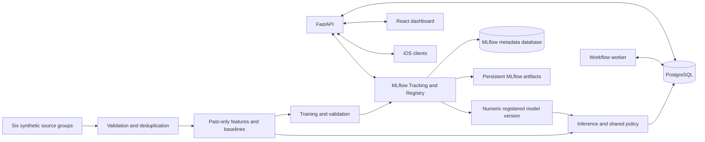

# SimeGuardian — Web Dashboard Implementation Plan

19 October 2026 · Version 0.4 · Main web UI and local model-to-response replay implemented

Contents: [Purpose](#1-purpose-and-completion-criteria) · [Stack](#2-technology-stack) · [Architecture](#3-architecture-and-boundaries) · [Phase map](#4-phase-map) · [Detailed phases](#5-detailed-phases) · [Acceptance](#6-acceptance-and-verification-matrix) · [Milestones](#7-demonstration-and-delivery-milestones) · [Change impact](#8-change-impact-and-implementation-discipline) · [Limits](#9-deferred-work-and-known-limits) · [References](#10-technical-references)

## 1. Purpose and completion criteria

Build the web MLOps dashboard and the shared services needed to demonstrate a real synthetic-data → trained-model → incident → iOS pop-up journey. The dashboard must let an operator inspect evidence, run experiments, select a model and trace every notification and response.

This plan expands the selected stack into executable phases. The [local MLflow prototype](MLFLOW.md) logs real synthetic runs/models. The main React/FastAPI UI now covers the screen inventory, including dataset/source exploration, training/evaluation/registry, actual champion inference on explicit synthetic windows, a persisted incident/escalation replay, operations, demo controls and a server-scoped responder identity. The [dashboard runbook](DASHBOARD.md) identifies implemented behaviour and limits. The source explorer remains separate from model feature generation; native iOS delivery, production identities, complete incident policies and episode evaluation are pending. Phase checkboxes remain unchecked until their complete integration gates pass.

Source documents:

- [Business and Product Requirements](REQUIREMENTS.md): authoritative product behaviour, required screens and acceptance scenarios.
- [Homepage Design Specification](DESIGN.md): visual reference for brand colours, typography and shapes. Its public-homepage sections and promotional interactions are outside dashboard scope.
- [Project overview](../README.md): summary and documentation entry point.
- [MLflow prototype](MLFLOW.md): runnable tracking/registry setup, evidence and integration boundaries.
- [Native iPhone plan](MOBILE_IMPLEMENTATION_PLAN.md): current Swift/SwiftUI client selection and mobile contracts.

If this plan conflicts with the requirements, preserve the requirements and update this plan. Dataset sizes and experimental thresholds below remain proposed defaults until recorded in versioned configuration and evaluated. The requirements mention both a 23 October proposal deadline and a prototype target; distinguish these when assigning delivery dates in Phase 0.

The prototype is complete when:

1. Six synthetic source groups pass through validation, causal features and actual trained-model inference.
2. Dataset versions, household/time splits, training runs, evaluation and model activation/rollback are inspectable.
3. A backend-generated incident produces a real foreground iOS family pop-up with matching incident and notification identifiers.
4. Unanswered alerts progress to resident at +5 minutes and township at +10 minutes, with persisted deadlines and idempotent transitions.
5. Family acknowledgement, completed human outcomes, resident help requests and sustained AI recovery have distinct recorded behaviour.
6. Missing data, away mode, consent and withdrawal rules apply consistently to inference, delivery and every role view.
7. Dashboard, iOS and worker remain consistent after refresh, reconnect, retry and process restart.
8. All required acceptance scenarios in the requirements have a passing check or an explicitly unresolved failure; an unresolved required failure means the prototype is incomplete.
9. MLflow records an initial model and at least one genuine retraining round, with predecessor/data lineage, comparable validation results and explicit promotion/rejection history. Evolution is demonstrated by real changes; improvement is claimed only where measured results support it.

## 2. Technology stack

These are implementation recommendations for this prototype. Resolve compatible stable package versions during Phase 1, record supported runtimes and commit lockfiles. Keep runtime behaviour reproducible rather than installing floating versions on startup.

| Concern | Selection | Responsibility |
| --- | --- | --- |
| Dashboard | React + TypeScript + Vite | Client-rendered operator application; Vite creates the static production bundle |
| Routing | React Router | Required views, incident deep links and refreshable URLs |
| Styling and controls | CSS + semantic React/platform controls | Current workspace uses shared styles, labelled forms and native dialogs; no existing house component library needs to be duplicated |
| Charts | Recharts | Utility/feature timelines, coverage distributions, evaluation and operational charts |
| Backend | Python + FastAPI + Pydantic + Uvicorn | Validated REST API, authentication, scoped event stream, policy and response actions |
| Persistence | PostgreSQL + SQLAlchemy + Alembic + psycopg | Shared operational state, source/feature records, constraints and schema migrations |
| Data and ML | pandas + NumPy + scikit-learn | Reproducible generation, causal baselines/features, Isolation Forest and evaluation |
| Experiment tracking and registry | MLflow Tracking + Model Registry | Runs, parameters/metrics, dataset lineage, registered versions, candidate/champion aliases and comparison UI |
| Artifact storage | MLflow-managed persistent volume; sklearn model flavor + JSON/CSV | Versioned models, input signatures, environments, manifests and reports; references in application records |
| Background execution | Python worker + separate training process | Persisted jobs and workflow deadlines; CPU training must not block escalation or withdrawal checks |
| Delivery | REST + authenticated WebSockets | Reads/actions plus foreground events; persisted fetch/replay restores state after reconnect |
| Demo authentication | Seeded accounts + PyJWT + pwdlib/Argon2 | Short-lived bearer tokens using FastAPI's documented pattern; enforce role, household and assignment access on the server |
| Resident/family client | Swift + SwiftUI in Xcode | Required app pop-ups, deep links, setup, response actions and sharing controls |
| Verification | pytest, Vitest, Playwright, XCTest/XCUITest | Domain/database checks, focused UI tests, browser journeys and client delivery tests |
| Local packaging | Docker Compose + npm + Python virtual environment | Reproducible database/API/worker setup; native Xcode tooling runs separately |

React owns presentation; FastAPI owns model execution and workflow decisions. Application PostgreSQL owns operational state; MLflow owns experiments and registered artifacts, backed by a separate database/user in the same PostgreSQL instance. The runnable local smoke uses SQLite as described in its runbook. The dashboard may use component state and a small typed API client initially; introduce a client-state library only if concrete caching or coordination needs justify it.

The first integrated deployment shape is a single API instance, one workflow worker, a separate training process, an MLflow tracking service and one PostgreSQL instance with separate application/MLflow databases. The API can serve the built dashboard from the same origin. Persist both databases and MLflow artifact volumes. Keep an API URL configurable for the iOS simulator or device; a phone cannot reach the development computer through the phone's own `localhost`.

This single-instance design is a prototype limit. Record a `shortcut:` comment near the process-local connection manager if used; upgrade to shared event fan-out when multiple API instances are required. Persisted notification records, rather than the connection manager, determine delivery history.

## 3. Architecture and boundaries



### 3.1 Invariants shared by every phase

- Use the same domain functions for offline evaluation, online inference and replay. Evaluation must report raw rule/model candidates separately from the policy decisions that reach participants.
- Validate units, identifiers, identity scope, timestamps, allowed actions and bounded parameters at trust boundaries. Never accept executable code, arbitrary filesystem paths or client-selected recipient identities.
- Store timezone-aware UTC timestamps. Display local time as `Asia/Kuala_Lumpur`, including the timezone label where ambiguity matters.
- Keep observation time, availability time, decision time, scheduled notification time, actual dispatch time and client receipt time distinct.
- Persist a shared demo clock and scenario identifier. All processes use the same effective clock for scenario logic; retain wall-clock audit timestamps too. Browser countdowns only display server deadlines.
- Authentication expiry, event-ticket lifetime and infrastructure timeouts use real server time even during a simulation; advancing the demo clock cannot extend credentials or bypass security checks.
- Advance simulated time through due events in chronological order. Label simulation time in both clients and record scheduled versus actual dispatch times; do not invent delivery or backdate client receipt.
- Use one unresolved incident per household, unique notification stage/recipient keys and idempotent response keys. Repeated evidence attaches to the existing incident.
- Commit workflow transitions and their notification records atomically. Dispatch after commit; retry the same logical event rather than creating duplicate alerts.
- Recheck consent, sharing permission, current responses and incident state immediately before a monitoring decision or notification dispatch.
- Keep data-source availability independent from incident status. Missing, delayed or failed data never becomes zero usage or an automated claim of personal safety.
- Every inference links dataset, feature window, MLflow run ID, registered model name/numeric version and policy version. Resolve an alias once during activation; never let an alias change silently alter an incident's evidence. Every participant action links the authenticated actor, incident, action and server timestamp.
- Operator evidence is restricted to synthetic/demo data. Family and township responses expose only permitted incident details; hiding a page in the sidebar is insufficient access control.

### 3.2 Proposed repository structure

Create directories when their phase needs them; the tree describes responsibilities, not a requirement to scaffold empty files.

```text
SimeGuardian/
├── web/                       # React application, package.json and lockfile
│   └── src/
│       ├── app/               # Router, shell, authentication and shared layout
│       ├── pages/             # Pipeline, datasets, training, evaluation, models, incidents, operations
│       ├── components/        # Used shadcn controls, charts and shared evidence displays
│       └── lib/               # Typed API/event contracts and formatting
├── backend/
│   ├── pyproject.toml         # Dependencies and reproducible environment instructions/lock
│   ├── app/
│   │   ├── main.py            # FastAPI startup, route registration and static bundle mounting
│   │   ├── api/               # Validated HTTP/WebSocket boundaries and scoped responses
│   │   ├── models.py          # Database records and constraints
│   │   ├── schemas.py         # Request, response and event contracts
│   │   ├── auth.py            # Seeded account authentication and authorisation
│   │   ├── clock.py           # Shared real/simulated time calculation
│   │   ├── pipeline/          # MLflow smoke runner now; full generation/features/training/evaluation later
│   │   ├── policy.py          # Coverage, conflict, away and recovery decisions
│   │   ├── incidents.py       # Ownership, transitions, outcomes and handoffs
│   │   ├── notifications.py   # Durable events, attempts and scoped delivery
│   │   └── worker.py          # Due work and training-process coordination
│   ├── migrations/            # Alembic schema history
│   └── tests/                 # Domain, API, database and restart checks
├── mobile/                    # Native iOS app and focused client tests
├── tests/e2e/                 # Browser journeys using the real API and test database
├── artifacts/                 # Local MLflow database/artifacts and generated files; ignored by Git
├── compose.yaml               # Planned API, worker, MLflow, databases and volumes
├── .env.example               # Placeholder configuration; no credentials
└── docs/
    ├── REQUIREMENTS.md
    ├── DESIGN.md
    └── IMPLEMENTATION_PLAN.md
```

Keep shared logic inside the Python application. Avoid creating a generic framework, multiple backend services or a second implementation of policy in TypeScript/Swift.

### 3.3 Minimum persisted records

| Records | Minimum purpose and constraints |
| --- | --- |
| Users, households, memberships and contact acceptance | Resident identity, linked family, operator role, assigned responder and accepted contact; synthetic profile fields are excluded from model shortcuts |
| Consent, away periods and withdrawal requests | Authorised scopes, effective dates, request/deadline/completion times and follow-up disposition |
| Dataset versions and split membership | Seed, generator/configuration version, checksum, household/date partitions and excluded episodes |
| Source observations and source status | Source group, household/person scope, event/available times, interval/unit/value, trip/passage linkage, missingness and feed errors |
| Feature windows and scenario labels | Versioned causal inputs; labels stored separately and excluded from inference queries |
| Application training jobs and serving references | Durable job state plus MLflow experiment/run/model identifiers; active numeric version, frozen policy and activation audit; do not recreate MLflow's registry schema |
| MLflow experiments, model versions and evaluation artifacts | Parameters, dataset/code/environment lineage, actual metrics/logs, artifacts and aliases; episode reports include counts, denominators, delays, coverage, recovery and untouched-test use |
| Inference decisions | Feature window, scores, reason codes, coverage/conflicts, all version references and resulting incident link |
| Incidents, incident events and response tasks | State, owner, episode linkage, outcomes, accepted township work and explicit handoffs/cancellation acknowledgement |
| Notifications and delivery attempts | Stable event ID, recipient/stage, payload scope, creation/dispatch/receipt/open status, failure/retry and human response links |
| Jobs and demo runs | Work type, persisted state/attempts, clock/scenario version, worker heartbeat and restart reconciliation |

Use foreign keys and uniqueness constraints for identity and duplicate prevention. Index the actual access paths: dataset/household/time, incident history, pending deadlines and recipient/event cursor. Paginate observations, logs and events server-side; aggregate long timelines before sending chart data.

### 3.4 API and event contracts

The route names below are proposed boundaries. Freeze their request/response examples in Phase 0 and keep FastAPI OpenAPI, TypeScript types, Swift Codable parsing and fixtures aligned when contracts change.

| API group | Suggested endpoints | Access |
| --- | --- | --- |
| Session | `POST /api/auth/token`, `GET /api/me`, `POST /api/events/ticket` | Seeded authenticated users; event ticket is short-lived and single-use |
| Pipeline | `GET /api/pipeline`, `GET /api/sources` | Operator; participants receive their own reduced source-status view |
| Datasets | `POST /api/datasets`, `GET /api/datasets`, `GET /api/datasets/{id}`, observation/feature/split subresources | Operator; creation accepts a validated generator configuration |
| Experiments | `POST /api/training-runs`, `GET /api/training-runs/{id}`, logs, `POST /api/evaluations` | Operator; authorised API reads MLflow run results, with separate validation/test rules |
| Models | `GET /api/models`, `POST /api/models/{id}/activate`, `POST /api/models/{id}/rollback` | Operator; MLflow numeric version references, compatibility/quality checks and application activation audit |
| Inference | `GET /api/inferences`, `GET /api/inferences/{id}` | Operator evidence only |
| Incidents | `GET /api/incidents`, `GET /api/incidents/{id}`, `POST /api/incidents/{id}/actions` | Household/assignment-scoped payloads and server-validated actions |
| Notifications | `GET /api/notifications?after=...`, receipt/open actions, operator retry action | Own events; operators see authorised synthetic traces |
| Resident settings | Consent/contact acceptance, away periods and withdrawal request/status endpoints | Resident-controlled settings; contacts accept only their own invitation |
| Township work | Assigned tasks, accept, outcome, handoff and cancellation acknowledgement actions | Assigned responder only |
| Operations and demo | `GET /api/operations`, scenario load, clock advance and demo reset endpoints | Operator; demo-only mutations disabled outside demo mode |
| Event stream | `WS /api/events` | Authenticated user-scoped events, cursor/reconnect support |

An event envelope includes `event_id`, event type, incident/reference ID, permitted recipient scope, stage where relevant, created time, deadline, minimal reason and deep-link route. Operator event payloads may include version/trace references; family/responder payloads exclude raw evidence.

Use explicit delivery states: created, dispatch attempted/accepted, client received, opened, human acknowledged/responded, failed or unknown. An open or transport acknowledgement is not a human response. Exchange a short-lived event ticket over authenticated REST before connecting the browser WebSocket; avoid long-lived credentials in URLs or logs.

### 3.5 MLflow integration and model-evolution evidence

Use the MLflow SDK in the Python training process and MLflow's HTTP API behind operator-authorised FastAPI routes. The main dashboard contains training configuration, job outcomes, run comparison/evidence and registry promotion/rollback; operators do not need to leave SimeGuardian for MLflow's separate UI. Participant clients never receive MLflow credentials or raw artifacts.

Each training attempt records dataset/split fingerprints, source-code revision or checksum, feature/policy versions, seed, parameters, environment, change reason, predecessor run/version, actual metrics and the sklearn model signature/artifact. Log domain episode/recovery metrics explicitly; estimator autologging cannot supply them. Retraining creates a new run and registered version even when it is rejected.

Demonstrate two chronological training rounds: an initial normal-routine dataset and a new version including reviewed later normal history from training households only. Evaluate both against the same validation benchmark and disclose its fingerprint, eligibility and denominators. If either benchmark or evaluator changes, mark the runs non-comparable until both are evaluated under the same protocol. Never reuse the final test partition to create a continuing improvement curve.

MLflow aliases `candidate` and `champion` provide convenient registry pointers. The application stores a resolved numeric version plus the complete feature/policy bundle as its serving configuration. Validate/download the candidate before atomically activating it, record an audit event, then reconcile the MLflow alias; the application database and MLflow cannot commit one distributed transaction. A failed promotion leaves the last-known-good artifact active. Existing incidents retain their original versions.

Monitoring or reviewed feedback may prompt an operator to start retraining. No drift event automatically promotes a model; family responses are reviewed outcomes, not automatically training labels. Keep failed/regressing candidates visible and report unchanged or worse results honestly. The local runner implements model-only window checks; full episode-level promotion/recovery gates and application activation remain Phase 3/5 work.

When MLflow is unavailable, new tracking/activation shows a visible failure and cannot claim success. The application may continue inference with its already validated loaded model. Operator monitoring, access controls, backup/restore of metadata plus artifacts, migration handling and alias reconciliation belong in the integrated setup.

## 4. Phase map

Phases are completion gates, not fixed calendar promises. During Phase 0, assign a named owner to each phase and estimate dates from actual team availability. Existing work may begin against frozen fixtures, but dependent phases cannot pass their exit checks against mocked evidence.

| Phase | Result | Depends on | Main requirements |
| --- | --- | --- | --- |
| 0 | Scope, contracts and acceptance checklist | Existing requirements | All required FRs and non-functional rules |
| 1 | Running shell, persistence, accounts and shared clock | 0 | FR-1 foundations; timing, access and accessibility |
| 2 | Reproducible six-source dataset and inspectable pipeline | 1 | FR-2 foundations, FR-3, FR-11 data, FR-12 data views |
| 3 | MLflow-tracked initial/retrained models, evaluation and versioned artifacts | 2 | FR-2, FR-4, FR-11, FR-12 MLOps |
| 4 | Trained inference to iOS pop-up and 5+5-minute response | 1–3 | FR-5, FR-7 human workflow, FR-10 |
| 5 | Complete operator dashboard and operational evidence | 2–4 | FR-12, model activation/rollback |
| 6 | Sustained recovery, full participant controls and withdrawal | 3–5 | FR-1, FR-6, FR-7 recovery/handoffs |
| 7 | Verified, reproducible demonstration and handover | 0–6 | Every required acceptance scenario |

FR-8 water/leak insight and FR-9 weekly summaries remain optional and are excluded from prototype completion. Do not add them while required gates remain open.

## 5. Detailed phases

### Phase 0 — Freeze scope, contracts and acceptance examples

**Goal:** remove ambiguity about what each client and service must implement before creating application code.

**Prerequisites:** read the requirements, this plan and the brand reference. Existing product decisions already authorise the prototype scope; routine implementation decisions do not require another approval step.

**Implementation tasks:**

- [ ] Assign accountable owners for web, shared backend/workflow, data/ML, iOS and final integration; one person may own multiple areas.
- [ ] Record the intended milestone dates and distinguish proposal submission from prototype completion. Estimate work from available people and completed gates.
- [ ] Translate every row in the requirements' demonstration table into a named scenario with inputs, expected decisions and observable outcomes.
- [ ] Freeze examples for source observations, feature windows, model decisions, incidents, notification events, responses and errors.
- [ ] Define identity scope: enrolled resident, another household member, household/shared identity, family account and unknown actor.
- [ ] Define the role/action matrix and separate operator evidence from participant/responder payloads.
- [ ] Specify consent/contact acceptance, incident states, response ownership, delivery states and withdrawal status as separate concepts.
- [ ] Define `t0` as successful creation of the first family in-app alert. A failed creation leaves timing unstarted; transport failure remains visible and is never labelled as an unanswered delivered alert.
- [ ] Adopt versioned experimental defaults: dataset seed/size/splits, causal warm-up, rule thresholds and recovery candidate settings. Mark these as proposed settings rather than measured outcomes.
- [ ] Define a small deterministic development fixture and a separate representative evaluation dataset/challenge pack. Keep scenario labels out of event payloads used by inference.
- [ ] Define the MLflow experiment/model naming, run/version lineage contract, comparable-validation protocol and explicit promotion/rejection gates. The existing local smoke fixture does not close the full data/model gates.

**Touches:** this plan, contract examples under `docs/`, acceptance checklist and later seed/test fixtures. Keep the product requirements as the authoritative source; update them only for an actual product decision.

**Deliverables:** an implementation-ready contract set, named scenario checklist, ownership/milestone notes and a default experiment configuration.

**Verification and exit gate:** walk through normal activity, an unanswered incident, a human resolution, a delivery failure, recovery and withdrawal using the contracts. Each boundary has stable IDs, actor scope, timestamps, failure semantics and a permitted reader. All required scenarios have an assigned verification phase.

### Phase 1 — Foundation, persistence, accounts and dashboard shell

**Goal:** run the web and backend against a real database with shared time and scoped demo identities.

**Prerequisites:** Phase 0 contracts and role matrix.

**Implementation tasks:**

- [ ] Create the Vite React/TypeScript application, React Router routes and the FastAPI application; pin compatible dependencies and record runtimes.
- [ ] Add PostgreSQL connection handling and Alembic migrations. Create identity, household, consent/contact, demo-clock and job records first; add domain tables with their consuming phases.
- [ ] Add Compose services, database/artifact volumes, readiness checks and `.env.example`. Keep generated data, secrets, local databases and model files out of Git.
- [ ] Add the MLflow tracking service with a dedicated PostgreSQL database/user, proxied persistent artifacts, `MLFLOW_TRACKING_URI` and operator-only UI access. MLflow manages its own schema; back up before upgrades and keep application migrations separate.
- [ ] Seed resident, family, operator and responder accounts with synthetic households. Hash passwords, load signing secrets from environment and implement bounded token expiry.
- [ ] Enforce account membership, accepted contact and assignment checks in API dependencies and response queries. Add the event-ticket boundary when implementing streaming.
- [ ] Implement resident opt-in and contact acceptance records so no monitoring can begin without the required permissions. These controls must work through the API before the first inference journey.
- [ ] Implement one persisted effective clock shared by API/worker and exposed read-only to both clients. Real mode uses server time; simulated mode visibly identifies its scenario and clock.
- [ ] Build login, sidebar, page header, filters, empty/loading/error states, source-status badges and the incident timeline skeleton.
- [ ] Apply brand red/orange accents, neutral content surfaces and readable typography. Use a system sans-serif fallback unless approved font assets are bundled; maintain contrast for small text.
- [ ] Provide keyboard focus, labelled controls, responsive navigation and text accompanying status colours. Use fixture data only where clearly labelled until its API is ready.

**Touches:** `web/` configuration and shell, `backend/app/main.py`, authentication, clock, initial schemas/migrations, Compose, environment examples, seeds and README setup instructions.

**Deliverables:** locally running authenticated shell, persistent demo identities/permissions, repeatable migrations and shared clock endpoint.

**Verification and exit gate:**

- [ ] A fresh database migrates and seeds cleanly; restarting services preserves accounts and clock state.
- [ ] Unauthenticated access fails. Changing a household ID or role field cannot grant access; a family user cannot read operator dataset endpoints.
- [ ] Two independent clients display the same effective time. Refreshing cannot reset the scenario clock.
- [ ] The web application type-checks/builds; login and navigation work with keyboard input and at desktop/compact widths.

### Phase 2 — Synthetic data, ingestion and dataset exploration

**Goal:** create reproducible, valid six-source data and make its coverage and partitions inspectable.

**Prerequisites:** Phase 1 persistence, identity contracts and clock.

**Implementation tasks:**

- [ ] Implement fixed-seed generation for electricity, water, parking/car-plate movement, mall activity, gate access and resident app activity.
- [ ] Start with the small development fixture, then generate the proposed 120 households × 90 days at 15-minute intervals plus sparse events. Record actual counts; six source groups do not imply six dense readings per interval.
- [ ] Vary routine, living arrangement, sleep/active periods, weekday/weekend activity, mobility and utility baseload independently of concern labels.
- [ ] Generate ordinary variation, sustained concern, away periods, conflicting activity, shared cards, duplicated trips, delayed/out-of-order records, failed feeds, meter resets and offline clients.
- [ ] Validate source schema, units, interval ordering and timestamp/identity links. Quarantine invalid records with a reason; report stage counts and errors instead of silently discarding them.
- [ ] Deduplicate observation IDs and repeated gate passages. Link parking/gate records for one trip to a single movement observation; preserve their provenance.
- [ ] Store observation time and availability time independently. Distinguish missing, stale, failed and available source states.
- [ ] Create immutable dataset manifests with generator/configuration versions, seed, canonical content checksum, split membership and exclusions. Regeneration creates a new version rather than overwriting a referenced dataset.
- [ ] Log MLflow training/validation dataset inputs and attach the immutable manifest to every consuming run. Preserve application dataset IDs and distinguish the local smoke fixture from the full dataset.
- [ ] Split household identities and time ranges before fitting or feature selection. Keep complete episodes and overlapping windows together; exclude episodes crossing scored cutoffs.
- [ ] Add paginated dataset/observation APIs, source-coverage summaries and the first functional Pipeline and Dataset Explorer pages.
- [ ] Show labels as evaluation annotations only; exclude label/scenario columns from the inference-input response and model feature allowlist.

**Proposed partition configuration:**

| Partition | Household group | Fitted/scored period | Allowed use |
| --- | --- | --- | --- |
| Train | 84 distinct households | Days 1–60 after warm-up | Fit global preprocessing and model using normal routine windows |
| Validation | 18 other households | Days 61–75 | Select model, thresholds, policy and recovery settings |
| Test | 18 further households | Days 76–90 | Evaluate the frozen configuration once for the reported version |

Use the proposed 14-day causal warm-up consistently. Earlier unlabelled holdout-household history may initialise that household's routine, but cannot fit the global model or select thresholds. The 70/15/15 split refers to households; disclose actual scored windows, episodes, eligible histories and exclusions.

**Touches:** generator/ingestion code, dataset/source records and migrations, deterministic fixtures, manifests, Pipeline and Dataset Explorer pages and their API contracts.

**Deliverables:** reproducible development and evaluation datasets, validation report, immutable split manifest, inspectable source timelines and coverage.

**Verification and exit gate:**

- [ ] Same configuration/seed reproduces the canonical checksum and split membership.
- [ ] No household or episode crosses partitions; holdout warm-up is absent from global fitting inputs.
- [ ] Invalid units, reversed intervals, duplicate passages, delayed data and missing feeds have checked outcomes.
- [ ] Dataset explorer counts agree with stored records and the manifest; large ranges are paginated/aggregated.
- [ ] Labels are independently injected scenarios, not simply the same 20%/60-minute rule applied to generate ground truth.

### Phase 3 — Causal features, baseline, model training and evaluation

**Goal:** produce a genuinely trained, versioned anomaly model and an honest comparison with the rule baseline.

**Prerequisites:** Phase 2 validated dataset and immutable partitions.

**Implementation tasks:**

- [ ] Build one feature implementation used by training, evaluation and live replay. Include past-only utility baselines/ratios, linked personal activity, deduplicated movement, gate-frequency deviation, app activity and coverage/freshness.
- [ ] Only consume observations where `event_time <= window_end` and `available_at <= decision_time`. Build the baseline from history preceding the evaluated window; avoid circular baselines using the current deviation.
- [ ] Represent insufficient history, zero/nonpositive baselines and unusable feeds explicitly. Avoid division-by-zero or imputation that converts unavailable evidence into inactivity.
- [ ] Implement the comparison rule: both utility feeds below 20% of their positive baselines for a completed 60-minute expected-active window, with arrival within 15 minutes of its end; apply away, coverage and resident-linked conflict checks.
- [ ] Keep missing parking/mall/gate context visible and treat likely-home state as uncertain where evidence is insufficient. No absence of events or isolated exit proves home/away status.
- [ ] Train one Isolation Forest candidate on normal routine training windows. Exclude IDs, age, scenario metadata, labels, generator parameters, responses and future information from inputs.
- [ ] Compare raw rule-only, model-only and combined decisions on validation. Select the exact combined policy and thresholds explicitly; participant incidents always require both fresh corroborating utility deviations and shared safeguards.
- [ ] Add persisted training-run states: queued, running, completed and failed, with actual steps, logs and errors. Run CPU work in a separate process while workflow deadline processing stays responsive.
- [ ] Save artifact checksum, dependency versions, preprocessing/feature definition, dataset/split references, parameters, threshold, policy version and metrics. Write artifacts atomically before marking a run complete.
- [ ] Integrate MLflow run creation, explicit domain metrics and `mlflow.sklearn` artifact logging/registration into the real training job; store IDs in application job records and expose tracking failures honestly.
- [ ] Train an initial version and at least one genuine later-data update using training households only. Log predecessor, change reason, data/code/environment lineage and a fixed-validation comparison. Record rejected candidates; do not manufacture an improvement to satisfy the demo.
- [ ] Reconcile interrupted jobs after restart: mark stale runs interrupted/failed with a visible retry action and preserve the previously active model. Do not display successful completion without its artifact/report.
- [ ] Define episode matching, detection delay origin, evaluable household-day exposure and unsupported-data exclusions before reporting results.
- [ ] Report episode precision/recall and confusion counts, unnecessary alerts per household-day, detection delay, duplicates, coverage failures and routine/availability subgroup results, with counts and denominators. Mark undefined metrics rather than substituting zero.
- [ ] Keep the test partition unavailable for threshold sliders/model selection. Freeze the selected artifact and complete policy, including recovery settings, before the one final test run in Phase 7.
- [ ] Implement explicit candidate activation and rollback with audit events and compatibility checks. A current incident retains the model/policy snapshot that produced it.
- [ ] Resolve MLflow aliases to numeric versions, verify the complete artifact/signature/policy bundle and switch application serving references atomically. Mirror/reconcile aliases after activation; a tracking outage cannot replace the loaded active model.

**Touches:** feature/baseline/policy code, training/evaluation entry points, worker process handling, run/model/report records and migrations, artifact persistence, minimal training/model APIs and focused ML fixtures/tests.

**Deliverables:** an actual completed training run, rule/model validation comparison, reproducible artifact, selected validation configuration and backend activation/rollback.

**Verification and exit gate:**

- [ ] Future and not-yet-available observations cannot change an earlier decision; feature inputs match between offline and online paths.
- [ ] Fitting uses only permitted normal training examples; validation does not refit global preprocessing and test remains untouched.
- [ ] One unusual utility, stale utilities, shared-card activity and unavailable feeds produce the required policy decisions.
- [ ] Re-running the recorded configuration reproduces outputs within declared numerical tolerances.
- [ ] Failed training, interrupted execution, missing/corrupt artifacts and incompatible activation preserve the previous active artifact and show the real failure.
- [ ] A small hand-labelled episode fixture verifies the evaluator's counts, false-alert denominator and detection delays.
- [ ] MLflow contains two real training/version records with comparable validation lineage, plus promotion/rejection evidence. Loading a registered version reproduces predictions; a rejected or failed candidate leaves the serving reference unchanged.

### Phase 4 — Incident engine, notification delivery and first iOS journey

**Goal:** make actual selected-model inference create a traceable family pop-up and the required unanswered response sequence.

**Prerequisites:** Phases 1–3, an active artifact, seeded consent/contact acceptance and a reachable iOS development target.

**Implementation tasks:**

- [ ] Persist inference scores, evidence/coverage, policy decisions and references before showing them in the dashboard. Keep blocked candidates inspectable without sending an alert.
- [ ] Create or update one unresolved household incident transactionally. Use a database uniqueness constraint and locking/conditional updates to prevent duplicate incidents from concurrent workers.
- [ ] Create the first minimal family notification and establish `t0` only on successful creation. Persist resident and township due times from `t0`; do not use browser timers or reset deadlines after retry.
- [ ] Commit incident transitions and notification records in the same transaction. The dispatcher reads committed pending events, rechecks current permissions/state and records attempts/results.
- [ ] Implement scoped WebSocket delivery from persisted events. For the single API instance, reading new records by cursor is sufficient; the database remains authoritative after connection loss.
- [ ] Add catch-up fetch after reconnect, expired-ticket recovery and event-ID deduplication. The iOS client records receipt/open only when observed and fetches current incident state before applying actions.
- [ ] Build iOS login, a labelled demo home, family/resident incident detail, foreground pop-up and incident deep link. Use a template reason derived from actual policy codes.
- [ ] Add family acknowledgement, completed check-in, resident confirmation and resident help/contact actions. Viewing/opening an alert does not acknowledge responsibility.
- [ ] Implement unanswered-stage checks in the worker with persisted deadlines and transactional rechecks. Family acknowledgement stops unsent unanswered stages but retains open follow-up and ownership.
- [ ] Add the minimal assigned township task surface and explicit acceptance/outcome actions. Restrict its payload to necessary incident details.
- [ ] Record late responses and rejected stale actions in the incident timeline without silently replacing an accepted action owner. Use idempotency keys so double taps/retries do not repeat transitions.
- [ ] Expose creation/dispatch/receipt/open/failure and response evidence in a basic web trace view. Failed or unknown delivery must remain visible; explicit demo retry must preserve the original logical event.
- [ ] Handle later-stage failures independently: a failed resident notification is visible and retryable, without resetting or suppressing the township deadline. At +10 minutes, apply the current response/permission checks and show any earlier-stage delivery failure alongside the escalation. A delayed retry must recheck whether its stage is still appropriate.

**Core response table:**

| Trigger | Required behaviour |
| --- | --- |
| Successful family alert creation | Family stage at `t0`; persist +5/+10 deadlines |
| Failed first alert creation | Delivery failure; no invented `t0`, acknowledgement or unanswered escalation |
| `t0+5`, no family acknowledgement or outcome | Create resident notification once; show actual delivery state |
| `t0+10`, no family acknowledgement or resident response | Create assigned township escalation once, subject to current permissions; retain earlier-stage failure/unknown status |
| Family takes responsibility | Assign owner and cancel unsent unanswered stages; incident stays open |
| Resident asks for help/contact | Record response and action owner; stop unanswered progression and block automatic closure until explicitly addressed |
| Resident confirms wellbeing or authorised human records a completed outcome | Record actor/outcome, resolve incident and cancel unsent stages; preserve accepted township task disposition |
| Concurrent response and escalation | Serialise against persisted state; retain any already committed alert and reject a later transition that current state has cancelled |

If transport delivery is unknown or failed, show that fact at every later stage. A stage schedule does not prove that the recipient received an alert. Capture notification delays independently from response intervals.

**Touches:** incident/policy/notification domain code, PostgreSQL constraints, worker deadlines, event contracts, iOS client, basic web trace page, database concurrency tests and delivery fixtures.

**Deliverables:** first complete selected-model-to-family-pop-up journey, resident/township stages, human response actions and matching trace IDs in both clients.

**Verification and exit gate:**

- [ ] One qualified inference produces one incident and a real iOS pop-up; dataset/window/model/incident/event references join correctly.
- [ ] Boundary checks at immediately before/at +5 and +10 minutes send each eligible stage once. Refresh/restart does not change deadlines.
- [ ] Acknowledgement is distinct from resolution; help remains open. Completed outcomes stop later unsent alerts.
- [ ] Duplicate inference, notification retry, double tap, offline/reconnect and late-response races preserve consistent incident/task ownership.
- [ ] Unlinked family users and unassigned responders cannot fetch or subscribe to the incident. Test database constraints/races on PostgreSQL, not a substitute database.

### Phase 5 — Complete operator dashboard and operational evidence

**Goal:** make every required dashboard view useful against real persisted results.

**Prerequisites:** Phases 2–4 APIs, real artifacts and end-to-end events. Continue using the existing shell and components.

**Implementation tasks:**

- [ ] Complete each view in the screen inventory below with filters, stable deep links, loading/empty/error states, pagination and last-update information.
- [ ] Connect dataset generation and training actions to real persisted jobs. Display actual step changes or elapsed time when measurable progress is unavailable; do not invent percentage progress.
- [ ] Add validation-only threshold exploration and rule/model/combined comparison. Changing a threshold creates a new evaluation/policy version rather than mutating a completed report.
- [ ] Implement the model registry UI: candidate/active distinction, dataset/run links, activation, prior-version rollback and compatibility/failure feedback.
- [ ] Extend the implemented local React/FastAPI workspace to the full episode-level experiment/registry lifecycle, preserving its training controls, comparisons, fingerprints and in-app evidence panels. Clearly separate application serving configuration from registry selection; no external MLflow UI is required.
- [ ] Show the complete inference → policy → incident → notification → response trace and distinguish operator evidence from the minimal participant reason.
- [ ] Add operations summaries for source availability/delay, missingness, job errors, inference/alert volume, notification creation-to-receipt latency and worker heartbeat.
- [ ] Compare recent eligible feature distributions with a versioned reference, using the same feature version and visible sample counts. Define freshness and missingness per source/window; sparse-source silence alone is not a failed feed.
- [ ] Show drift as review evidence. Insufficient samples/coverage produce an explicit insufficient-data state; drift never auto-trains or auto-activates a model.
- [ ] Add the operator-only demo panel: select a named scenario, advance shared time, inspect its identifier and reset only that demo run.
- [ ] Keep immutable datasets, completed training/evaluation evidence and model artifacts outside destructive replay reset. Confirm reset in the UI and record an audit event; never point it at production/real data.
- [ ] Support desktop, tablet and narrow-screen layouts without hiding critical status/actions. Include units, timezone, denominators and missing-data gaps in charts; provide readable text/table equivalents.

**Screen inventory:**

| Route | Required content and actions |
| --- | --- |
| `/pipeline` | Six source groups; ingestion/validation/features/inference/notification stage counts; freshness, rejected records, errors and stage details |
| `/datasets` and `/datasets/:id` | Version/seed/checksum; split membership; eligible/excluded counts; household/source timelines, labels as evaluation annotations and distributions |
| `/training` and `/training/:id` | Real job state/logs; MLflow experiment/run and predecessor links; parameters, data/code versions and labelled prior-run replay |
| `/evaluation` | MLflow-backed rule/model/combined reports; same-benchmark run comparison; validation-only trade-offs; counts/denominators and final-test status |
| `/models` | MLflow registered numeric versions and aliases; application-active configuration; feature/policy compatibility and activation/rollback history |
| `/inference` and `/incidents/:id` | Scored window, actual reason/coverage, policy decision and shared incident/event/response timeline |
| `/operations` | Feed delays/missingness, volumes, job/worker state, delivery latency/failures and feature-drift comparisons |
| `/demo` | Restricted scenario load/time/reset controls with visible simulation clock; account switching authenticates the actual seeded identity |
| `/response` | Separate restricted township view of assigned work, owner, outcome, handoff and cancellation acknowledgement; no raw operator evidence |

**Touches:** web pages/components/router/API types, aggregate API queries, operation metrics/reference snapshots, demo endpoints, scoped responder UI and browser fixtures/tests.

**Deliverables:** all required dashboard screens connected to real data, operator controls and limited responder view.

**Verification and exit gate:**

- [ ] Displayed counts, charts and trace links reconcile with persisted records and reports; selecting a filter never combines incompatible dataset/model versions silently.
- [ ] Refreshing/deep-linking works; failed jobs and API/stream outages produce honest recoverable states.
- [ ] Model activation/rollback and dataset/scenario changes refresh affected views without stale active-model labels.
- [ ] A responder sees only assigned work; choosing a different role in demo controls cannot bypass server permissions.
- [ ] Representative pages work with keyboard input, readable status text and chart alternatives at desktop/compact widths.

### Phase 6 — Sustained recovery, participant controls and withdrawal

**Goal:** complete the required consent, recovery and follow-through behaviour across every client.

**Prerequisites:** Phases 3–5 and a validation dataset containing recovery, ambiguous identity and open-response cases. Implement the backend permission checks from Phase 1 throughout earlier phases; this phase completes their participant UI and edge cases.

**Implementation tasks:**

- [ ] Complete iOS wellbeing setup: resident consent, monitored household, accepted family contact and permission for township escalation. Assisted setup does not transfer consent to the helper.
- [ ] Complete wellbeing overview with learned routine, all six source statuses/freshness, uncertain context, away periods and incident history. Show app activity attributed to the correct account/role.
- [ ] Implement resident-owned away start/end controls; suppress only new inactivity incidents during the period and preserve existing follow-up and deadlines.
- [ ] Implement the proposed recovery experiment: two consecutive completed 15-minute windows with fresh evidence from two independent groups, including meaningful activity explicitly attributable to the enrolled resident.
- [ ] Validate normal-range and recovery-score settings on validation episodes. Household utilities alone, shared cards, family sessions, app heartbeats and notification receipts/opens cannot satisfy the personal activity condition.
- [ ] Count parking and gate records for the same trip once. Missing/stale recovery feeds, failed inference, quiet periods or an unresolved explicit help request block automatic closure.
- [ ] On qualifying recovery, record `resolved_by_ai`, evidence windows/groups, effective time and model/policy versions. Notify all involved roles with scoped payloads and display “Activity pattern recovered.”
- [ ] Preserve accepted township tasks after AI or late human resolution until cancellation is acknowledged or an explicit handoff/outcome is recorded. Separate incident resolution from responder task completion.
- [ ] Prevent repeat alerts on the same historical window; a renewed post-resolution deviation opens a new linked episode only when new qualifying evidence exists.
- [ ] Add sharing/contact controls and withdrawal request/status UI showing request time, deadline no later than +23 hours, pending state and actual effective completion time.
- [ ] Process withdrawal promptly once the handoff/closure disposition is recorded; use +23 hours as the latest bound, not a mandatory delay. Pause new monitoring/sharing work while finalising pending withdrawal where practical.
- [ ] Before completion, record outstanding follow-up disposition. At completion, disable monitoring/sharing and cancel unsent monitoring notifications atomically. Do not wait beyond the deadline for manual handoff acknowledgement: record the explicit withdrawal handoff/closure and retain any accepted task's required acknowledgement state without continuing to share new wellbeing evidence.
- [ ] Recheck withdrawal status at API reads, stream delivery, retry, worker inference and job materialisation boundaries. Queued work and active subscriptions cannot bypass completed withdrawal.
- [ ] Keep withdrawal separate from deletion. Explain that the prototype uses synthetic data; real retention/deletion and training-data/model disposition require a separate agreed policy.
- [ ] Record administrative withdrawal closure separately from human check-in and AI recovery; it must not count as a wellbeing confirmation or a completed useful check-in.
- [ ] Finalise recovery policy/feature versions, validate closure failures and freeze the full selected configuration for Phase 7 test evaluation.

**Touches:** consent/away/withdrawal records and actions, recovery policy, worker scheduling, notification filters, follow-up tasks/handoffs, iOS settings/overview screens, dashboard histories/metrics and scenario fixtures.

**Deliverables:** complete resident controls, versioned sustained recovery, explicit responder disposition and observable 23-hour withdrawal handling.

**Verification and exit gate:**

- [ ] One signal resuming cannot close an incident. Valid sustained independent evidence with resident attribution can close; shared-card/household-only/heartbeat evidence cannot.
- [ ] Help requests prevent AI closure until addressed; family acknowledgement alone never resolves an incident.
- [ ] AI closure preserves an already accepted township action and notifies involved roles without exposing raw histories.
- [ ] Away mode leaves existing response work visible. Withdrawal shows pending until effective, completes within the bound across restart/clock advance, and blocks subsequent inference/sharing/retry.
- [ ] Family, resident, AI and township outcomes remain distinguishable in incident history and metrics. Recovery false-closure counts and time-to-recovery are reported on validation.

### Phase 7 — Integration verification, packaging and demonstration

**Goal:** deliver a reproducible prototype whose evidence and limitations can be inspected.

**Prerequisites:** all required Phase 0–6 gates, a frozen candidate/policy/recovery configuration and the untouched test partition.

**Implementation tasks:**

- [ ] Execute the acceptance matrix below using domain/API/database checks and representative real-client journeys. Fix required failures before marking their scenario complete.
- [ ] Evaluate the frozen full configuration on the untouched test partition once for the reported version. Save exact versions/checksums, counts, eligibility/exclusions, episode metrics and recovery false-closure/delay results.
- [ ] Keep a separate labelled challenge-pack report for rare edge cases. Do not present its deliberately balanced prevalence as an expected operating rate.
- [ ] After viewing test results, do not tune and reuse the same test as untouched evidence. Any further tuning needs a newly held-out evaluation protocol and a clearly labelled later report.
- [ ] Restart API, workflow worker, training process and iOS independently. Reconcile pending jobs/alerts and verify no duplicate notification, lost ownership or reset deadline.
- [ ] Run the full proposed dataset through aggregate queries and representative charts on the demonstration machine. Record machine/runtime, row counts and observed timings; optimise confirmed bottlenecks with pagination, aggregation and targeted indexes.
- [ ] Verify authentication expiry, user/assignment scoping, bounded job requests, invalid actions and artifact loading. Load only internally generated, checksum-verified model artifacts; do not accept untrusted joblib uploads.
- [ ] Verify HTTPS/WSS and secret/configuration handling for any remotely accessible demo. Keep database ports private and demo mutations gated; local-only development remains the default.
- [ ] Build the web bundle and backend containers, apply migrations to a clean database, seed accounts and restore the selected artifacts. Verify persistent volumes and a backup/restore procedure for demonstration evidence.
- [ ] Add the actual setup, test, seed/generate/train/evaluate, start/stop and recovery commands to README or a runbook. Document device networking and demo account configuration without committing passwords/tokens.
- [ ] Run a browser/iOS accessibility and usability pass: keyboard/focus, readable labels, large resident actions, status text, errors, chart alternatives and desktop/compact layouts.
- [ ] Rehearse the judge walkthrough below, including at least one delivery/offline failure and a clearly labelled prior training run if used.
- [ ] Record completed gates, known failures/limits and exact artifact versions. Leave pilot commitments and unvalidated outcomes as proposals.
- [ ] Verify MLflow HTTP logging and artifact download, registry loading, tracking-service restart, metadata/artifact restore and failed-promotion retention. Rehearse initial → retrained candidate → comparison → explicit promotion/rejection → rollback.

**Touches:** targeted fixes across callers/contracts, tests, CI configuration, Compose/build configuration, README/runbook, acceptance evidence and the final evaluation report.

**Deliverables:** passing required checks, test/challenge reports, a clean-start demonstration, versioned artifacts, operating instructions and recorded limitations.

**Verification and exit gate:** all prototype completion criteria in Section 1 and every required scenario in the product requirements are satisfied. Packaging must work from documented instructions rather than relying on an undocumented local process or temporary file.

## 6. Acceptance and verification matrix

This matrix groups related checks; it supplements rather than replaces the individual acceptance rows in [the requirements](REQUIREMENTS.md#demonstration-and-acceptance). The final evidence checklist should link each named scenario to its test/report/manual walkthrough result.

| Scenario group | Expected evidence | Primary phase / check |
| --- | --- | --- |
| Consent and accepted contact | Monitoring remains disabled until resident opt-in, accepted family contact and escalation permission exist | 1, 6 / API and iOS |
| Normal routine; no mall/parking/gate events | Source status shown; no incident or automated personal-safety assertion | 2–4 / policy fixture |
| Sustained dual-utility deviation | Fresh positive baselines, qualifying window and no resident-linked conflict create one policy-approved family incident with model comparison | 3, 4 / policy and integration |
| Only one unusual utility | Candidate may be visible to operator; no participant incident | 3 / policy fixture |
| Missing/stale/failed utility; inadequate baseline | Insufficient evidence; no zero substitution or inappropriate alert | 2, 3 / ingestion/features/policy |
| Explicit resident-linked movement/mall/app activity | Conflicting evidence blocks a new household-only inactivity incident without declaring wellbeing | 3 / identity/policy fixture |
| Other household member, shared card, family session or heartbeat | No false personal attribution, inappropriate suppression or AI recovery | 2, 3, 6 / identity/recovery fixtures |
| Reduced gate frequency or unavailable gate feed | Supporting context or missing evidence; no independent alert and no invented zero use | 2, 3 / source/policy fixture |
| Duplicate card reads and parking/gate same trip | One passage/movement observation; provenance retained | 2, 6 / deduplication fixture |
| Late/out-of-order observation; future data | Original decision uses only information available at that time | 2, 3 / causal replay fixture |
| Away or outside expected active period | No new inactivity incident; current follow-up remains visible | 3, 6 / policy and UI |
| Trained inference to client | Actual artifact produces inference and matching incident/event IDs; iOS receives and displays pop-up/deep link | 4 / real client integration |
| Five and ten unanswered minutes | Resident then township stage once, based on persisted deadlines, including boundary/refresh/restart cases | 4 / clock and database integration |
| Family acknowledgement versus outcome | Acknowledgement assigns responsibility/stops unsent stages; only completed outcome resolves | 4 / API and iOS |
| Resident confirmation versus help | Confirmation resolves; help stays open with owner and blocks AI closure until addressed | 4, 6 / API and iOS |
| Late response, duplicate action and escalation race | One incident; idempotent events; explicit ownership/handoff; cancelled transitions cannot execute later | 4, 6 / PostgreSQL concurrency |
| First alert creation failure; later transport failure | Failed creation does not start `t0`; failed/unknown delivery is visible, retryable and never invented as receipt | 4 / notification integration |
| Resident-stage failure | Original +10 deadline remains; escalation shows earlier failure honestly; retry respects current state | 4 / worker integration |
| Offline client, reconnect and app restart | Fetch authoritative incident, replay/deduplicate persisted events and preserve delivery uncertainty | 4, 7 / iOS and stream integration |
| One resumed source or household-only recovery | Evidence accumulates or closure is blocked; no automatic resolution | 6 / recovery fixture |
| Sustained independent recovery with resident attribution | Distinct AI outcome with windows/groups/versions and scoped notifications | 6 / recovery integration |
| Recovery failure, stale source or unresolved help | No AI closure | 6 / recovery fixture |
| Resolution after township accepts | Accepted task remains until explicit cancellation acknowledgement, handoff or outcome | 4, 6 / task integration and UI |
| Renewed deviation after closure | New linked episode from new qualifying evidence; historical windows do not re-alert | 6 / episode fixture |
| Withdrawal requested, pending and completed | Honest timestamps; completion within 23 hours; explicit outstanding-work disposition | 6 / clock and UI |
| Queued work/subscriptions after withdrawal | No further monitoring or sharing through API, stream, retry or worker | 6, 7 / permission race integration |
| Failed dataset/training job or corrupt artifact | Real failure shown; active model remains usable; no invented metrics/progress | 2, 3, 5 / worker/API/UI |
| Regeneration, partitions and label leakage | Same seed/configuration reproduces data; household/episode separation and feature allowlist hold | 2, 3 / deterministic and leakage checks |
| Model switch/rollback during open incident | New inference uses selected version; open incident retains its evidence/policy snapshot | 3, 5 / registry integration |
| MLflow evolution and regression | Two genuine runs/versions, predecessor/data/code lineage and comparable validation; failed quality gate retains active model | 3, 5, 7 / MLflow integration |
| MLflow unavailable or alias update fails | Existing loaded model continues; new tracking/activation failure is visible; application/alias state is reconciled without changing historical incidents | 3, 5, 7 / fault integration |
| Frozen untouched-test evaluation | Parameters and recovery policy frozen before test; report records one evaluation and all denominators | 7 / evaluator/report review |
| Operator/family/responder isolation | Direct URL, guessed ID, changed filter and stream requests cannot cross permitted scope | 1, 4–7 / negative API/stream tests |
| Clock advance/reset | Shared labelled time; chronological processing; only selected demo-run state reset, immutable evidence retained | 1, 5, 7 / clock/demo integration |
| Accessible and honest dashboard | Keyboard actions, status text, units, timezone, missing-data gaps and chart alternatives; no fabricated risk/safety/progress | 1, 5, 7 / browser and manual review |

### 6.1 Test boundaries

- Use small deterministic pytest cases for causal features, episode metrics, policy, recovery and clock boundaries. Test outcomes and trust boundaries rather than mirroring implementation details.
- Use a dedicated PostgreSQL test database for uniqueness, transactions, migration compatibility and response/escalation/withdrawal races. Never reset the development or demonstration database as a test fixture.
- Use Vitest only for non-trivial client behaviour such as event deduplication or status rendering. Do not create a test for every static component.
- Use Playwright for login/scope, dataset-to-model navigation, the incident trace, model changes and demo controls against the real API.
- Use XCTest/XCUITest and one simulator/device walkthrough for actual foreground reception, pop-up/deep-link actions, identity attribution and reconnection.
- Do not stub the trained model, delivery event or backend timer in the final end-to-end acceptance path. Label prior-run replays and simulated time explicitly.
- Add CI when runnable code exists: frontend type-check/build and focused tests, backend tests with PostgreSQL, iOS checks and the selected browser smoke journeys. Run expensive full generation/training once per relevant change or release, rather than on every documentation edit.

## 7. Demonstration and delivery milestones

| Milestone | Observable result | Required gates |
| --- | --- | --- |
| A — Foundation | Scoped users, dashboard shell, real database and shared clock | 0–1 |
| B — Inspectable model evidence | Reproducible data, causal features, completed real training/validation and selected artifact | 2–3 |
| C — First complete alert | Selected-model inference produces family pop-up, +5/+10 progression and human outcome with shared IDs | 4 |
| D — Complete dashboard | All operator views, operational evidence and restricted response/demo controls work | 5 |
| E — Complete workflow | Sustained AI recovery, participant controls, handoffs and withdrawal work | 6 |
| F — Demonstration ready | Required checks pass, test evidence is frozen and clean setup/restart succeeds | 7 |

### 7.1 Judge walkthrough

1. Show the synthetic-data label, enrolled elderly resident, accepted contact and visible simulation clock.
2. Inspect six source groups, dataset version, split membership, source coverage and a normal routine timeline.
3. Compare the initial and genuinely retrained version in MLflow: predecessor/data changes, same-validation metrics and explicit promotion/rejection. Show artifact and rule/model/combined results. If replaying completed runs, label them as prior runs; report unchanged/worse results honestly.
4. Show the selected model and replay an eligible deviation. Open its feature window, coverage checks and inference decision.
5. Match the inference to its incident and notification ID, then show the real family iOS pop-up and deep link.
6. In a fresh unanswered branch, advance labelled time to +5 and +10; show resident notification, assigned township work and unchanged persisted deadlines after refresh.
7. In separate branches, demonstrate family acknowledgement versus completed check-in, resident confirmation and an open request for help.
8. Show invalid recovery being rejected, then valid sustained independent recovery with an explicit AI outcome and accepted-task disposition.
9. Show a stale-feed or offline/delivery-failure case and its honest status/retry behaviour.
10. Request withdrawal, display pending/deadline and effective completion, then verify no later monitoring/sharing occurs.
11. Finish on the frozen test report, separate challenge-pack evidence and the remaining real-data/operating assumptions.

### 7.2 Handover package

- [ ] README/runbook with supported runtimes, environment placeholders, migrations, seed/generate/train/evaluate/start/test commands and iOS network setup.
- [ ] Committed application source, lockfiles, migrations, bounded experiment defaults and deterministic development/challenge fixtures.
- [ ] Immutable dataset/split manifest, chosen artifact/checksum, frozen policy/thresholds and validation/test reports stored in the persistent artifact location.
- [ ] Named acceptance evidence, browser/client walkthrough notes and any required failure still open.
- [ ] Model activation/rollback, failed-job retry, notification retry, process restart, backup/restore and safe demo-reset instructions.
- [ ] A clear distinction between implemented prototype behaviour, proposed experimental defaults and unproven field outcomes.

## 8. Change impact and implementation discipline

Before each code change, trace the affected API/domain function through every caller and keep its connected surface complete:

| Change | Places that must stay aligned |
| --- | --- |
| Schema or state transition | Migration, ORM record, constraints, policy/worker, API schema, web/Swift readers, seeds, fixtures and integration checks |
| Event contract or delivery state | Event writer, persisted replay, WebSocket scope, iOS parsing/pop-up, dashboard timeline, receipts and reconnect tests |
| Feature/model/policy version | Generator manifest, offline/online feature code, training/evaluator, registry activation, incident snapshot, chart labels and reports |
| Permission or withdrawal rule | REST reads/actions, stream subscriptions/dispatch, queued jobs/retries, resident UI, responder tasks and negative access tests |
| Clock/deadline logic | Stored deadlines, worker due processing, recovery windows, withdrawal bound, demo controls, both clients and boundary/race tests |
| Route or UI control | Router exports, deep links, API client, role navigation, accessibility/error handling and affected browser fixtures |
| Configuration or runtime | `.env.example`, dependency locks, Compose/build configuration, device URL instructions, CI and runbook |

Prefer existing domain functions/components and platform facilities. Keep one policy implementation and add only the dependencies/components required by these phases. Never simplify away validation, data-loss prevention, access scope, accessibility or required workflow handling.

## 9. Deferred work and known limits

| Item | Current treatment | When to revisit |
| --- | --- | --- |
| Real utility, gate, parking and mall feeds | Synthetic data only; no provider credentials or permissions assumed | Separate data-access and identity-linkage validation before a pilot |
| Production identity/security operations | Seeded demo accounts with server checks demonstrate boundaries; not proof of production readiness | Before introducing real people/data or a public service |
| Background/closed-app push, SMS or calls | Foreground iOS stream is the required path; no external communications | Explicit additional scope and validated delivery requirements |
| Additional models, LLM explanations, leak insights and weekly summaries | One anomaly candidate and template reasons; FR-8/FR-9 deferred | After all required prototype gates and a concrete usefulness decision |
| Distributed queue, Redis, Kubernetes and larger orchestration platforms | MLflow Tracking/Registry is included; keep remaining execution to the single API/worker and PostgreSQL | Measured throughput, multiple API instances or operating needs justify further infrastructure |
| Persistent-volume loss or incompatible artifacts | Back up demonstration evidence; pin environment and verify artifact checksums | Hosted storage/recovery requirements before wider use |
| Clinical or field effectiveness | Synthetic scenario metrics demonstrate pipeline/workflow behaviour only | Representative real-data evaluation and supervised operating validation |
| Localisation, fallback channels and wider resident cohorts | Required readable accessible prototype first | Pilot/accessibility research and an explicit scope decision |
| Retention, deletion and model-data disposition | Withdrawal disables monitoring/sharing; historical deletion is a separate policy | Before real data is collected or trained on |
| Staffed township response, funding and service targets | Simulated assigned responder; no staffing/funding commitment | Separate pilot readiness and operating agreements |

No billing, hardware procurement, medical classification, fall detection, emergency-service dispatch or public-homepage recreation is needed to complete this plan. Calendar estimates depend on assigned capacity; none of the proposed pilot targets is a measured prototype result.

## 10. Technical references

The following official documentation supports the selected tools. The architecture, phase order, worker arrangement and contracts above are project design proposals, not claims that these tools provide SimeGuardian's workflow automatically.

- [Vite guide](https://vite.dev/guide/) and [static deployment](https://vite.dev/guide/static-deploy): React/TypeScript setup and static production bundles.
- [shadcn/ui with Vite](https://ui.shadcn.com/docs/installation/vite): the supported component integration path.
- [Recharts](https://recharts.github.io/en-US/): React chart components.
- [FastAPI WebSockets](https://fastapi.tiangolo.com/advanced/websockets/): event connection handling and authentication dependencies.
- [FastAPI JWT and password hashing](https://fastapi.tiangolo.com/tutorial/security/oauth2-jwt/): documented token/password primitives; this implementation uses PyJWT and pwdlib with Argon2 rather than inventing cryptography.
- [FastAPI background tasks](https://fastapi.tiangolo.com/tutorial/background-tasks/): request background-task behaviour and considerations for heavy computation. Persistent jobs and a separate training process are this plan's implementation choice.
- [PostgreSQL indexes](https://www.postgresql.org/docs/current/sql-createindex.html) and [explicit locking](https://www.postgresql.org/docs/current/explicit-locking.html): constraints/indexes and transactional concurrency primitives.
- [scikit-learn Isolation Forest](https://scikit-learn.org/stable/modules/generated/sklearn.ensemble.IsolationForest.html) and [common pitfalls](https://scikit-learn.org/stable/common_pitfalls.html): anomaly-model behaviour and avoiding preprocessing/data leakage.
- [Docker Compose](https://docs.docker.com/compose/): reproducible multi-container development setup.
- [MLflow tracking server](https://mlflow.org/docs/latest/self-hosting/architecture/tracking-server/), [model registry workflow](https://mlflow.org/docs/latest/ml/model-registry/workflow/) and [sklearn integration](https://mlflow.org/docs/latest/api_reference/python_api/mlflow.sklearn.html): SQL-backed tracking, persistent artifacts, registered versions/aliases and model logging/loading.
