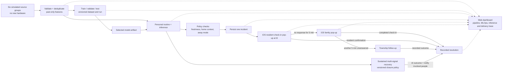

# SimeGuardian — Business and Product Requirements

18 October 2026 · Tan Hao Wen  
Version 0.6 · Native iPhone stack and MLflow-backed model evolution

This is the single requirements document for SimeGuardian. It combines business rationale, product behaviour, technical requirements, dataset and AI design, prototype acceptance and proposed rollout. Confirmed decisions are distinguished from design defaults and field/business proposals. This document specifies the work; it does not claim that datasets, applications, trained models or pilot results already exist.

| Item | Detail |
| --- | --- |
| Programme | Sime Darby Property University Hackathon 2026, Township of Tomorrow |
| Working category | People / Community Wellbeing; safety and accessibility are supporting benefits |
| Proposal deadline | 23 October 2026, 11:59 p.m. |
| Current stage | Requirements and dataset design for review |
| Review status | Dataset/model defaults, field pilot, pricing and outcome targets remain proposals |

## Contents

- [Confirmed decisions](#confirmed-product-decisions)
- [Problem, evidence and target users](#problem-statement-and-objectives)
- [Scope and functional requirements](#goals-and-scope)
- [Architecture and resident journey](#high-level-implementation-and-architecture)
- [Mobile stack and implementation plan](#mobile-app-technology-and-implementation-plan)
- [Data sources and dataset design](#data-and-detection-requirements)
- [AI, MLOps and recovery](#ai-and-mlops-requirements)
- [Alert handling and app communication](#alert-handling)
- [Screens and acceptance](#required-screens)
- [Pilot, impact and funding](#proposed-pilot-plan)
- [Privacy, risks and open decisions](#privacy-consent-and-compliance)
- [Sources and supporting material](#sources)

## Executive summary

SimeGuardian is an opt-in wellbeing service for elderly SDP township residents first, with expansion to other residents after initial validation. It combines household routines, likely-home context and AI anomaly detection, prompts a check-in when a pattern changes unexpectedly, and records responses and recovery. The initial cohort is residents aged 60+ who live alone or spend long periods alone.

- **Focus area:** Theme 1 People, Community Wellbeing, addressing physical wellbeing through follow-up and mental wellbeing through human contact. No mental-health assessment or loneliness inference is included.
- **How it works:** Combine simulated electricity, water, parking/car-plate movement, mall, gate and resident app data. Ask the resident to check in through an app pop-up first; after five minutes without a response, notify the selected family contact; after another five unanswered minutes, notify an authorised township responder. Family or resident confirmation can resolve the incident. AI may also close after sustained recovery across multiple signals, with an explicit recovery outcome and notification to involved people.
- **Who it serves:** Elderly residents first, resident-selected family contacts and authorised township responders; broader resident groups follow after validation.
- **Why SDP:** It explores whether permissioned township and service data can support residents after handover. Existing data access, ownership and useful reporting frequency remain to be established.
- **Current deliverable:** A native iPhone resident/family app built with Swift and SwiftUI in Xcode, a separate web dashboard showing the data pipeline and MLOps, a designed synthetic dataset, actual model training/evaluation and an inspectable anomaly-to-app pop-up journey. Existing SDP app matching is unnecessary.
- **Proposed next stage:** Approximately 3 months, one precinct and 30–50 elderly opt-in households, subject to software-accessible data, consent, staffing, funding and model/policy validation. No new hardware is required.
- **Differentiation hypothesis:** Utility-based watching services exist overseas. The proposal explores combining household patterns and township context with a clear human response workflow; local novelty has not been established.

## Confirmed product decisions

| Area | Agreed scope |
| --- | --- |
| Eligible users | Residents aged 60+ first; expand to other residents after initial validation |
| Application | Native iPhone app built with Swift and SwiftUI in Xcode, with resident and family roles; Android is a later scope decision |
| Operations | Web dashboard showing the pipeline, datasets, training runs, model evaluation and inference-to-app notification delivery |
| MLOps tooling | MLflow Tracking and Model Registry for real experiment history, dataset/code lineage, registered model versions and reviewed promotion/rollback |
| Model evolution | Demonstrate an initial model and at least one genuine retraining round on later training data; compare under the same validation protocol and retain rejected candidates; improvement requires measured evidence |
| Monitoring unit | Detect changes at household level, then check on the enrolled resident |
| Data sources | Combine electricity, water, parking/car-plate movement, shopping mall activity, guarded-gate access cards and resident app activity; all simulated |
| Detection | Combine learned personal routines, likely-home context, cross-signal checks and a trained anomaly model; retain a simple rule baseline for comparison |
| Dataset | Reproducible synthetic training and validation data plus an untouched test set, with household and time separation |
| Safeguards | Away mode, corroborating signals, and explicit handling of missing or delayed data |
| Mental wellbeing | Human check-ins only; no mental-health assessment |
| Response | Resident app check-in at t0; family at t0+5 minutes without response; township at t0+10 minutes if still unanswered |
| Resolution | Family records an outcome in app, resident confirms wellbeing, or AI records sustained recovery across independent signals |
| Consent | Opt-in participation, resident-selected contacts and limited responder access |
| Withdrawal | Complete withdrawal of monitoring and sharing within 23 hours; display requested, pending and completed status |
| Hardware | No additional sensors, wearables or other new hardware |
| Prototype | Native SwiftUI iPhone app, separate web MLOps dashboard, synthetic data pipeline, real model training/evaluation and working app pop-up alerts |

## Problem statement and objectives

The entry addresses **Theme 1 People**, on the **Community Wellbeing** track covering residents' physical and mental health. The briefing asks teams to solve a specific problem in township life after homes are handed over. See the [hackathon reference](</Users/limjiale/SDP Hackathon/SDP_HACKATHON_REFERENCE.md>).

When a resident's routine changes unexpectedly, family and township support teams may lack a shared way to notice the change, decide whether a check-in is needed, and confirm that someone has followed up.

A resident living alone may have no one nearby to notice a concern. The product explores whether everyday service data can prompt useful human contact. Household activity does not establish an individual's condition, detect a fall or demonstrate a medical emergency.

**Business objectives**

1. Turn an unexplained deviation in an elderly resident's routine into an app check-in and a recorded human or sustained-recovery outcome.
2. Keep unnecessary alerts low enough that residents, families and township responders trust the workflow.
3. Test a software-only, permissioned-data approach using a transparent training and inference pipeline, with no new hardware.
4. Explore post-handover resident engagement and a measurable community wellbeing benefit for SDP.

**Prototype success** means the iOS/web journey, dataset partitions, actual model training/evaluation, 5+5-minute response sequence and recorded human/AI-recovery outcomes in [Demonstration and acceptance](#demonstration-and-acceptance) work consistently. A later elderly-first pilot would assess usefulness, unnecessary alerts, missed concerns, response times, data access and acceptance. Numerical field targets remain proposals.

The proposed product explores whether permissioned data from everyday services can provide useful prompts for human check-ins. The background research does not establish the accuracy of this approach.

Physical wellbeing is addressed through follow-up when activity patterns warrant concern. Mental wellbeing is supported through human contact during check-ins. The first version does not assess mood, diagnose mental illness or infer loneliness from inactivity.

## Demand evidence and data sources

The share of adults aged 60+ living alone in non-institutional households rose from 6.3% in 2018 to 18.8% in 2025: a 12.5 percentage point increase, or almost three times the earlier share. This does not measure time alone during the day, isolation or the need for monitoring. See the [NHMS 2018 report, Table 3.5.1](https://iku.nih.gov.my/images/IKU/Document/REPORT/NHMS2018/NHMS2018ElderlyHealthVolume1.pdf) and [NHMS 2025 reports](https://iku.nih.gov.my/nhms2025).

The table retains background evidence from earlier research notes. Those additional figures have not been reverified in this consolidation; national and state indicators do not validate product accuracy or township demand.

| Indicator | Figure | Why it matters | Source |
| --- | --- | --- | --- |
| Older persons (60+) living alone | 18.8% (about 770,800) in 2025, up from 6.3% in 2018 | Supports the initial elderly target; does not validate detection performance | [NHMS 2025 via Bernama](https://www.bernama.com/en/bfokus/news.php?id=2618795) |
| Estimated people dying alone at home | About 3,500 cases a year (expert estimate) | Shows the harm of no one noticing | [Bernama, Oct 2026](https://www.bernama.com/en/bfokus/news.php?id=2618795) |
| Falls among people aged 60+ | 14.3% in 2025 (14.1% in 2018); living alone more than doubles fall risk | Background motivation for follow-up; the product does not detect falls | [CodeBlue, NHMS 2025](https://codeblue.galencentre.org/2026/04/only-15-of-malaysian-seniors-ageing-well-dementia-rate-up-nhms-2025/); [Bernama](https://www.bernama.com/en/bfokus/news.php?id=2618795) |
| Seniors with 2 or more chronic diseases | About 68%; dementia 9.8% | Higher risk of sudden incidents | [CodeBlue, NHMS 2025](https://codeblue.galencentre.org/2026/04/only-15-of-malaysian-seniors-ageing-well-dementia-rate-up-nhms-2025/) |
| Population aged 65+ | 8.0% in 2025, up from 7.6% in 2024 | The ageing trend is steady | [DOSM, Current Population Estimates 2025](https://www.dosm.gov.my/portal-main/release-content/current-population-estimates-2025) |
| Ageing-nation threshold (60+ above 15%) | Projected around 2030 by DOSM; 2036 under the National Policy for Older Persons | Demand keeps rising through the rollout period | [Malay Mail, DOSM 2024](https://www.malaymail.com/news/malaysia/2024/07/31/malaysia-set-to-become-ageing-nation-by-2030-perak-leads-senior-surge-dosm-report-says/145577); [The Edge](https://theedgemalaysia.com/node/762293) |
| Selangor and KL ageing outlook | Projected "super-aged" (65+ above 20%) by 2060 | SDP's core townships are in Selangor | [The Edge](https://theedgemalaysia.com/node/762293) |
| Household size and earners | 3.7 persons with 1.8 income earners per household (2024) | Household background; averages do not establish whether a home is empty or someone is alone | [DOSM, HIS 2024](https://www.dosm.gov.my/portal-main/release-content/household-income-survey-report--malaysia--states-2024) |
| Women in the labour force | 56.6% nationally (record high), 70.7% in Selangor (2025) | Employment background; does not directly measure availability for check-ins | [The Sun, DOSM 2025](https://thesun.my/news/malaysia-news/people-issues/putrajaya-leads-malaysia-in-women-labour-force-participation) |
| Adults with diabetes / hypertension | 15.6% / 29.2% (2023) | Broader wellbeing context; participation does not require collecting diagnoses | [NHMS 2023 fact sheet](https://iku.moh.gov.my/images/nhms2023/fact-sheet-nhms-2023.pdf) |
| Interest in fall detectors in a Malaysian study | 64% interested; 91.7% unaware; most expected a price below RM500; 336 participants aged 50+, published 2021 | Historical evidence for awareness, affordability and ease of use; not current sales or willingness to pay for SimeGuardian | [Original study](https://www.frontiersin.org/journals/public-health/articles/10.3389/fpubh.2021.612538/full) |

**What the data does not show yet.** These figures do not establish township demand. For the older-resident example, a research estimate could use:

*total occupied homes × share of households with a resident aged 60+ × share of those living alone or home alone in the daytime*

This estimates the initial elderly subgroup only; later expansion needs its own demand evidence. Use township-level figures from SDP if available, or label district-based estimates and their limitations. Assess interest in opting in separately.

**Proposed validation before 23 October:** a short survey of 15 or more adult children with a parent living alone, resident feedback on consent and usefulness, and 1–2 interviews with a township security or management team. Broader resident demand remains to be tested.

## Target demographics and personas

Target elderly residents aged 60+ first, particularly those living alone or alone for long periods, with resident-selected family contacts. Scale to other resident groups after initial usefulness, acceptance and operating feasibility are demonstrated. Participation is opt-in; no health diagnosis is required.

| Segment | Who | Role in the service | Scope |
| --- | --- | --- | --- |
| Initial resident | Opt-in resident aged 60+ living alone or alone for long periods | Gives consent, selects contacts, controls away mode and can confirm wellbeing | Initial cohort and main demonstration |
| Selected family contact | Adult child or close relative chosen by the resident | Receives an alert when the resident has not answered a check-in for five minutes, acknowledges responsibility and records the outcome | Prototype role; payer role unconfirmed |
| Expansion residents | Other adults living alone or seeking wellbeing support, including those managing long-term conditions | Same consent-led workflow, without medical assessment | Later expansion after initial validation |
| Authorised township responder | Designated security or management responder | Receives an incident after resident and family remain unanswered for 5 minutes each | Simulated role; real staffing to confirm |
| Data / MLOps operator | Team member responsible for the model and pipeline | Inspects synthetic data, training, validation, model versions and notification traces | Web dashboard; separate from family access |

**Persona: Madam Lee, 72.** Widowed, lives alone in a terrace house in a guarded SDP precinct. She uses WhatsApp but rarely opens other apps, and won't wear a pendant because it "makes her feel old."

**Persona: Daniel, 41.** Madam Lee's son. He works in KL, his wife also works, and they live 25 km away. He calls his mother most evenings but has no way of knowing she's fine during the day.

Different household routines require validation. The prototype uses labelled synthetic profiles and does not claim that one age group is more willing to participate or easier to monitor.

### Roles and access

| Role | Main need | Permitted view and actions |
| --- | --- | --- |
| Resident | Receive support while retaining control | Opt in, review connected sources, select contacts, set away mode, view own alerts, confirm wellbeing or request contact, withdraw participation |
| Selected family contact | Know when to check in and avoid duplicate responses | View alerts for the linked resident, acknowledge responsibility, record contact attempts and the check-in outcome |
| Data / MLOps operator | Inspect how an alert was produced | Web-only view of synthetic pipeline health, dataset versions and splits, training runs, metrics, model versions and notification traces |
| Authorised township responder | Follow up after the resident and family stages | Assigned incident and necessary details only; receives an unanswered incident at t0+10 minutes |

Responders do not receive utility histories, purchase details or movement trails. Sharing is limited to the incident and the information needed for follow-up. A person's activity must not be attributed to another household member.

## Business value for SDP

The business hypothesis is that useful check-ins and clearer follow-up support residents after handover and give families a reason to engage with township services. Ageing in place, retention and revenue benefits require later evidence. Cost recovery is a proposed funding aim.

| Value | How SimeGuardian delivers it | How it would be measured |
| --- | --- | --- |
| Ageing in place and retention | Potential support for older residents and their families | Longer-term resident tenure and buyer feedback; not established by the prototype |
| Sales differentiation | An "age-ready township" feature for new launches and multigenerational buyers | Launch take-up; marketing-attribution surveys |
| App engagement after handover | A useful resident-support workflow may encourage continued engagement | Participating-household usage of the eventual app, after integration is agreed |
| Reuse of existing assets | Permissioned service and township data may reduce additional equipment | Actual integration and operating costs compared with alternatives |
| Safer township reputation | Builds on SDP's earlier township safety work, such as the Ara Damansara Safe City initiative ([SDP](https://www.simedarbyproperty.com/node/135)) | Resident safety-perception survey |
| ESG reporting | A measurable social metric: households covered, check-ins resolved, welfare-check response times | Figures added to the sustainability report |
| Future extension | Leak warnings could be considered under a separate scope and consent decision | Feasibility and usefulness of an explicitly approved extension |

**Precedent from the property sector.** Earlier research notes cite R65's 2024 watching service for rental landlords in Japan using smart-meter data ([Kenbiya](https://www.kenbiya.com/ar/ns/for_rent/citem_service/8271.html)). This is a service precedent, not validation of this prototype's accuracy, local data access or operating model.

**Fit with SDP's stated purpose.** SDP describes real estate as a multiplier of value for people and the planet (briefing p. 9). This feature extends the township's value to residents well after handover.

## Goals and scope

The prototype must demonstrate a complete journey from an unusual household pattern to a recorded human check-in outcome or sustained multi-signal AI recovery. Residents and contacts must understand why an alert was raised, who is responding, and whether follow-up remains outstanding.

The first version includes enrolment, contact permissions, six simulated source groups, personal baseline learning, a trained anomaly model, away mode, the resident → family → township 5+5-minute workflow, response and recovery tracking, incident history and a web MLOps dashboard.

The current deliverable is the hackathon prototype. A real pilot is a separate, conditional next stage described in the [proposed pilot plan](#proposed-pilot-plan). Data is simulated from existing-service concepts; no physical water sensor or other hardware is to be purchased or installed. Resident app usage is included as context. Water leak warnings and weekly family summaries remain optional AI exploration candidates rather than required additions.

Cameras or audio inside the home, real provider connections, contracts, billing, medical measurements, automatic fall detection, mental-health assessments and emergency-service dispatch are outside the prototype. Machine-learning training on synthetic data is in scope. Provider access, data frequency and lawful use must be established before a real pilot.

**Prototype implementation defaults:** Use synthetic households and demo accounts. The backend emits real incident events to the iOS client, which shows a working in-app pop-up and opens the incident when tapped. Notification controls must not invent delivery or acknowledgement. A simple baseline and one trained anomaly-model candidate are sufficient to demonstrate the MLOps lifecycle; additional AI capabilities are explored separately.

### Functional requirements

| ID | Requirement | Priority |
| --- | --- | --- |
| FR-1 | Elderly resident opts in, confirms the home, links an accepted family contact and authorises township escalation | Must, prototype |
| FR-2 | Learn a household routine from past synthetic history for comparable days, windows and expected active periods | Must, prototype |
| FR-3 | Combine six minimal simulated source groups, including resident app activity, with identity scope, freshness and deduplicated movement context | Must, prototype |
| FR-4 | Compare a trained anomaly model with the rule baseline; apply likely-home context, corroboration, away mode and missing-data safeguards | Must, prototype |
| FR-5 | App check-in to the resident at t0; family at t0+5 minutes without response; township at t0+10 minutes if still unanswered | Must, prototype |
| FR-6 | Resident controls away mode; complete withdrawal of monitoring/sharing within 23 hours, with visible request, deadline and completion | Must, prototype |
| FR-7 | Keep one unresolved incident; distinguish acknowledgement, completed human check-in and sustained multi-signal AI recovery; record outcomes, notifications and handoffs | Must, prototype |
| FR-8 | Explore data-based water anomaly/leak insight without hardware; feasibility not yet established | Optional AI exploration |
| FR-9 | Explore a grounded weekly family summary with minimal disclosure | Optional AI exploration |
| FR-10 | iOS resident/family app receives backend events and renders working pop-ups, deep links and response actions | Must, prototype |
| FR-11 | Design reproducible train/validation/test data, train a candidate model, evaluate it and record versions and metrics | Must, prototype |
| FR-12 | Web MLOps dashboard shows pipeline, dataset/splits, runs, model versions, inference and notification traces | Must, prototype |

### Non-functional requirements

- **Prototype timing:** persist t0 and calculate family and township deadlines at t0+5 and t0+10 minutes. Preserve them across refresh and label accelerated demo time. Track the 23-hour withdrawal deadline separately.
- **Prototype consistency:** all roles share one incident and clock. Source availability is separate from check-in status. No automated green "Resident safe" status or invented health-risk score.
- **Prototype accessibility:** large readable text, labelled controls, keyboard access and status text alongside colour.
- **Prototype privacy:** synthetic inputs, minimal role views and withdrawal completed within 23 hours. Show pending until effective; no new monitoring/sharing after completion. Simulated roles do not establish production access control.
- **Model reproducibility:** record generator, split, feature, model and decision-policy versions; fit preprocessing on training data only; keep test data out of model selection. Show actual failures and metrics rather than invented training progress or a health-risk percentage.
- **Pilot proposals:** the earlier targets of processing within 15 minutes of a qualifying window and 99.5% ingestion availability need feasibility review and measurement definitions. These do not override the 5+5-minute response sequence. Establish encryption, access control, training-data governance, retention/deletion and audited 23-hour withdrawal before real use.
- **Pilot accessibility to review:** Bahasa Malaysia, English and Chinese localisation and optional SMS or voice-call fallback. No real communications integration is required for the prototype.

## High-level implementation and architecture

Six synthetic source groups feed validation, past-only features, a personal baseline and trained anomaly inference. A policy creates incidents and timed app notifications. iOS and the web dashboard share the same backend and trace identifiers; production hosting and real provider connections remain later decisions.

The simulator supplies minimal utility intervals, linked movement, app engagement, gate-frequency and data-status fields. No raw images, credentials or item-level shopping details are needed. See the detailed [dataset design](#dataset-design), [AI/MLOps workflow](#ai-and-mlops-requirements) and [backend-to-app communication](#model-to-app-communication).

| Layer | Prototype | Before a real pilot |
| --- | --- | --- |
| Inputs | Six simulated source groups; reproducible, partitioned dataset | Confirm software-accessible feeds, permissions, intervals, latency and identity linkage |
| Detection | Learned personal baseline, rule comparison and trained anomaly candidate | Validate accuracy, unnecessary alerts, recovery policy and baseline duration on real data |
| Model lifecycle | Actual train/evaluate/version/select workflow visible on web | Define approval, rollback, drift review and retraining responsibilities |
| Notifications | Backend event → iOS resident check-in pop-up → family after 5 unanswered minutes → township after another 5 | Establish real delivery, background push, fallback and response staffing |
| Views | iOS resident/family, web MLOps operator and limited township view | Establish authentication and separate operator versus participant access |
| Data | Minimal synthetic observations, versioned artifacts and shared incident history | Agree minimisation, 23-hour withdrawal, training-data disposition, encryption, retention and audit |

**Hackathon prototype (23 October):** inspect the dataset split and an actual training run, activate the model, then replay an elderly resident's routine and anomaly. Trace the resulting resident check-in pop-up to the same inference event. Demonstrate the family stage at five minutes, township at ten if unanswered, an app response and sustained AI recovery as alternative outcomes. Use demo accounts and a labelled simulation clock.

## Mobile app technology and implementation plan

The detailed plan is maintained in [Mobile App Implementation Plan](MOBILE_IMPLEMENTATION_PLAN.md), covering the native stack, app structure, API/events, notifications, implementation stages and verification. Product behaviour and acceptance remain in this requirements document.

## Resident and response journey

1. **Enrol:** An elderly resident opts in, confirms the monitored home, accepts township escalation and selects a family contact, who accepts the demo link. Explain sources, minimal sharing and the 23-hour withdrawal completion limit.
2. **Establish the usual routine:** Generate realistic synthetic history and learn a household baseline from past observations. Seeded history makes onboarding demonstrable without waiting two real weeks; no future observations may enter the baseline.
3. **Compare signals:** Compare valid electricity and water intervals with that routine. Parking/car-plate movement, mall, gate and resident app activity add identity-aware context about recent activity and whether the resident may be home.
4. **Identify a concern:** A rule or model candidate passes freshness, corroboration, away-mode and conflicting-context checks before creating one incident. Record the model, data and rule versions that produced it.
5. **Ask the resident first:** The resident receives an app check-in pop-up with a minimal reason, “I'm okay” and request-contact actions. Delivery, opening and response are separate events. Asking the resident first respects their autonomy and avoids worrying family over a nap or a quiet afternoon.
6. **Then alert family:** At t0+5 minutes, if the resident has not responded, the linked family account receives a pop-up with a minimal reason, time, incident link and response actions. If neither resident nor family responds by t0+10 minutes, escalate the same incident to the authorised township responder.
7. **Follow through:** Family can acknowledge responsibility or record a completed check-in outcome inside the app. A resident confirmation closes with an explicit outcome. The dashboard and app show one consistent timeline.
8. **Observe recovery:** Record whether usual activity resumes, including meaningful activity attributable to the resident. When the sustained multi-signal recovery policy is satisfied, AI closes with an explicit system outcome and notifies involved people. Show “Activity pattern recovered,” distinct from a personal wellbeing confirmation.

If the resident explicitly confirms “I'm okay,” record that confirmation and notify involved contacts. Family acknowledgement alone does not mean a check-in was completed. AI recovery closure has an auditable system actor and evidence; it must not be presented as a family response or a clinical finding.

## Data and detection requirements

### Combined simulated sources

| Source | Minimum useful input | Interpretation and limit |
| --- | --- | --- |
| Electricity | Consumption during a stated interval, observation time and feed status | A change in household consumption can support a routine deviation. Appliances can remain active when nobody is home. |
| Water | Consumption during a stated interval, observation time and feed status | A change can support another household signal. No water use by itself is not evidence of distress. |
| Parking / car-plate movement | Linked entry or exit events, event time, pseudonymous vehicle reference and feed status | Combines parking and guardhouse plate-derived movement without needing camera images. A car event is personal only when its identity link is explicit. |
| Shopping mall | Minimal linked visit or transaction event and time, with feed status | Adds recent activity context without item-level purchase data. No mall activity is normal for many residents and is not an independent concern. |
| Residential access card at the guarded gate | Successful access events, event time, entry or exit direction where recorded, resident or household card reference, use count per comparable interval, last successful use and feed status | Changes in gate-use frequency can support a routine deviation. No gate use alone does not indicate distress or prove that someone is home. Shared cards provide household context only; a card event does not establish who used it. |
| Resident app activity | Account role, pseudonymous user link, meaningful interaction type, observation time and app/feed availability | Active resident interactions can provide personal context. Family usage, background heartbeats, push delivery and automatic refresh do not establish resident activity or wellbeing. |

Every record must distinguish the household or linked person, when the event occurred, when it became available, and whether the feed is current. Late-arriving data is evaluated using its observation time, not treated as new activity at arrival.

For gate-use frequency, count successful passages, exclude failed attempts and remove repeated reads of the same passage. Link parking and gate records for the same trip as one movement observation rather than treating them as independent corroboration. Use a card reference for linkage; card credentials are unnecessary.

## Dataset design

The goal is representative, reproducible data for training and honest evaluation. A synthetic dataset can be complete for the planned scenarios; its scores cannot establish performance on real elderly residents. The sizes and split below are a proposed starting design, not completed dataset or training results.

### Dataset contents

Generate 120 synthetic elderly households across 90 days at 15-minute intervals, with separate sparse event records. Vary living arrangements, sleep schedules, weekday/weekend routines, utility baseloads, app usage and mobility. Use fixed, versioned generator seeds, and preserve the causal schedule that produced every labelled scenario.

| Table / artifact | Minimum fields and purpose |
| --- | --- |
| Household profiles | `household_id`, enrolled `resident_id`, synthetic age band, living arrangement, timezone, expected active periods and routine parameters. Demographic fields describe coverage; identifiers and age must not become shortcuts for the anomaly label. |
| Source observations | `observation_id`, source group, household/resident reference, `identity_scope`, `event_time`, `available_at`, interval boundaries, value/unit or event type, source status and `trip_id` where applicable. Missing values remain missing. |
| Feature windows | `window_id`, window end and decision time, causal utility-baseline ratios, elapsed time since linked personal activity, gate-frequency deviation, app activity, likely-home context, away mode, freshness/coverage flags and feature version. |
| Scenario labels | `episode_id`, start/end, scenario class, simulated concern / benign variation / insufficient evidence, explanation, injection seed and expected workflow. Labels describe the simulation, not a confirmed injury or diagnosis. |
| Split manifest | Household group, permitted dates, warm-up dates, episode membership, generator version, seed and immutable dataset checksum. |
| Experiment artifacts | Training configuration, feature/preprocessing version, dataset manifest, model artifact, validation metrics, decision threshold and evaluation report. |

### Training, validation and untouched test data

| Partition | Household group | Scored / fitted period | Permitted use |
| --- | --- | --- | --- |
| Training | 84 households, fixed 70% group | Days 1–60 after causal warm-up | Fit preprocessing and the anomaly model on normal routine windows; benign variations remain represented. Training concern episodes are excluded from normal-only fitting. |
| Validation | 18 different households, fixed 15% group | Days 61–75 | Compare the rule and model; choose parameters, alert threshold and any proposed recovery policy. Include concerns, legitimate quiet periods and feed failures. |
| Test | 18 further households, fixed 15% group | Days 76–90 | Evaluate the frozen pipeline and policy once for the reported version. Do not tune against this partition. |

Use a proposed 14-day past-only warm-up and rolling history for the personal routine. Holdout households may have earlier, unlabelled history to initialise their routine, as a newly enrolled household would. That history is not used to fit global preprocessing, select thresholds or train the shared model. Use the same warm-up procedure in every group. Report how much history and how many households are eligible for scoring.

Split household identities and time periods before feature fitting. Keep complete episodes and overlapping windows in the same partition; discard episodes that straddle evaluation cutoffs. Deduplicate linked trips and event identifiers before counts are calculated. Compute features using only events with `event_time` at or before the window end and `available_at` at or before the decision time. Exclude scenario labels, generator parameters, scenario IDs, notification outcomes and future activity from model inputs. Fit learned preprocessing only on training data. This follows the separation principles in the [scikit-learn guidance on data leakage](https://scikit-learn.org/stable/common_pitfalls.html).

The 70/15/15 figures describe household groups, not equal-length row partitions. Log actual windows, episodes, exclusions and label prevalence per partition. Use plausible low concern prevalence in the main validation and test replay; keep a separate balanced challenge pack for edge-case coverage. Do not present a deliberately balanced challenge set as the expected operating rate.

### Required scenario coverage

- Ordinary routines, late waking, naps, low-water days, irregular app usage, visitors and household members using services.
- Known away periods, trips without a car, no shopping/mall visits and an ambiguous home/away state.
- Sustained unusual inactivity while home context supports concern, isolated low utility use, and conflicting resident-linked app, parking, mall or gate activity.
- Missing or late utilities, source outages, meter resets, duplicate card reads, shared cards, paired parking/gate events, out-of-order arrivals and an offline app.
- Family acknowledgement versus completed check-in, resident confirmation, continued concern, activity recovery and notification failure.
- Withdrawal requested, pending and completed at the 23-hour limit; no new monitoring or sharing after completion.

Vary severity, duration, start times and household routines independently. Do not generate labels solely by applying the same 20%/60-minute comparison that the baseline will use: otherwise the experiment would reward reproducing its generator rather than detecting independent scenarios.

### Dataset acceptance

Require valid units and event times, stable identifiers, explicit missingness, no cross-partition households or episodes, no forbidden label/future features, reproducible split membership and a coverage report. Inspect distributions and sampled timelines in the dashboard before training. Report episode-level precision/recall, unnecessary alerts per household-day, detection delay, duplicate incidents, data-coverage failures and results by routine/availability group. Report counts and denominators; accuracy alone is insufficient for rare concerns. Synthetic scenario recall is not clinical sensitivity.

## AI and MLOps requirements

### Core experiment

Learn a personal routine from prior history, then compare a transparent statistical/rule baseline with one initial anomaly-model candidate. A proposed first candidate is Isolation Forest on baseline-normalised multi-signal features; it is an anomaly detector rather than a medical classifier ([official model documentation](https://scikit-learn.org/stable/modules/generated/sklearn.ensemble.IsolationForest.html)). Keep its score separate from any claim about health or a calibrated probability.

Train on normal routine examples, choose the alert threshold on validation episodes, and evaluate the frozen artifact on test episodes. The active artifact is selected explicitly and records dataset, feature, threshold and model versions. Show actual run state, parameters, metrics and failures. A saved completed run may be replayed for a quick demo, but must be labelled as a prior run rather than live training.

Use MLflow Tracking and Model Registry to record an initial model and at least one actual retraining round, with predecessor/change reason, data/split/code/environment lineage, measured metrics and registered artifacts. Compare evolving versions on the same validation benchmark, retain failed or regressing candidates, and explicitly record promotion/rejection and rollback. Additional versions alone do not establish improvement. Do not tune successive versions on the untouched test set; freeze the final configuration before its reported test evaluation. The [MLflow runbook](MLFLOW.md) describes the implemented synthetic feature-window smoke demonstration and its limits; full six-source, episode-policy and app integration remain in the [implementation plan](IMPLEMENTATION_PLAN.md).

The model and rule propose concerns; a shared policy checks signal coverage, likely-home uncertainty, away periods and conflicting personal activity. For the first inactivity experiment, require both valid utility feeds to corroborate a deviation. A model score with only one unusual utility remains an operator-visible candidate rather than a family incident. Neither an absent context feed nor a model score may bypass missing-data handling. Compare model-only, rule-only and combined results in the dashboard before selecting the active policy.

### Web dashboard

| View | Required evidence |
| --- | --- |
| Pipeline | Simulated source → ingestion → validation → features → inference → notification, with counts, freshness, errors and last update |
| Dataset explorer | Household/episode timeline, source coverage, labels hidden from inference inputs, split membership, distributions and generator version |
| Training | Start or replay a labelled run; inspect configuration, progress, logs, artifact and failure state |
| Evaluation | Rule/model comparison, episode metrics, confusion counts, threshold trade-offs and untouched-test status |
| Model versions | Active versus candidate version, training data reference, selection event and rollback to a prior artifact |
| Live inference and delivery | Household feature window, score, aggregate reason, incident ID and family/resident notification and response events on one timeline |
| Operations | Source delay, missingness, prediction/alert volume and observed feature drift; drift prompts review rather than automatic retraining on unreviewed outcomes |

### Additional AI capabilities to explore

| Capability | Useful outcome | Scope |
| --- | --- | --- |
| Personal routine learning | Adjust expected activity by household, day and time; distinguish ordinary variability from sustained change | Core experiment |
| Multi-signal anomaly detection | Compare a trained detector with the baseline and trace why a candidate became an incident | Core experiment |
| Recovery detection | Recognise sustained multi-signal recovery, close with a distinct AI outcome and notify involved people | Required workflow; exact model settings selected on validation |
| Grounded explanations | Convert verified reason codes into a short family-facing explanation or weekly summary | Explore; a template is sufficient initially; any language model must not invent evidence or control escalation |
| Drift and feedback analysis | Find changing routines and recurring unnecessary alerts to guide reviewed retraining | Dashboard exploration; no unreviewed self-training |
| Water-use anomaly / leak insight | Evaluate unusual continuous consumption using available interval data | Optional later feature; no new sensor and no current leak-detection claim |

Choose added capabilities using validation evidence and demo value. Model choice beyond the initial candidate remains an experiment; no deep-learning or language-model dependency is required to make the main anomaly-to-app journey work.

### Rule baseline for comparison

Use the following **illustrative baseline settings**, not validated health thresholds. The trained-model threshold is selected using validation; this rule remains an inspectable comparison and fallback when the policy permits it.

- Compare activity with a baseline learned from synthetic past history for the same type of day and time window.
- Evaluate only expected active periods, outside declared away periods.
- Require both electricity and water activity to remain below 20% of their respective baseline consumption for a completed 60-minute window. Both baseline values must be positive and both feeds must have arrived within 15 minutes of the window end.
- Do not count an absent, stale or failed feed as zero consumption. An insufficient baseline or insufficient valid signals produces “Insufficient data,” not an inactivity incident.
- Check parking/car-plate, mall, guarded-gate and resident app context before creating an incident. Meaningful activity explicitly linked to the enrolled resident within that window introduces conflicting evidence and prevents this household-only rule from creating a new incident. Show the conflict rather than claiming the resident is safe. Activity belonging to another person, a family app session or an unverified shared card cannot suppress the incident.
- Compare access-card frequency with the household or resident's usual gate-use pattern. Reduced use can support the explanation of a routine change, but cannot independently trigger an alert or replace the two required utility signals in the initial demo rule. An unavailable gate feed is missing evidence, not zero gate use.
- No shopping, parking or gate events does not add concern by itself. A parking or gate exit alone does not establish that the resident is away.
- Create one incident per unresolved episode. Additional qualifying updates attach to its timeline rather than sending duplicate alerts.

The interface explains the actual signal combination. It must not display an invented health-risk percentage or describe activity data as clinical vital signs. Two low utility readings may share an ordinary explanation, such as absence from home; corroboration does not establish a medical problem.

### Sustained recovery and AI closure

AI-based closure is approved in principle. Proposed initial demo settings are two consecutive completed 15-minute windows, providing 30 minutes of sustained recovery, with valid evidence from at least two independent source groups. Select normal-range and recovery-score thresholds on validation data, freeze them with the policy, and report false closures and time to recovery on the untouched test episodes.

At least one group must contain meaningful activity explicitly linked to the enrolled resident, such as an authenticated resident app interaction or reliably attributed movement; household utility consumption alone is insufficient. The other group must independently support a return to the learned routine. Parking and gate logs for the same trip count as one movement observation. An app heartbeat, notification receipt/open, shared card or family account session cannot satisfy the personal activity requirement.

Recovery must be observed after incident creation using fresh, available data. Missing feeds, a failed model, quiet hours, a low score without corroboration or an unresolved explicit request for help prevent automatic closure. On success, record `resolved_by_ai`, the recovery window, supporting source groups, model/policy versions and time. Notify family, resident and any involved township responder; display “Activity pattern recovered,” without declaring medical safety.

Do not silently cancel an accepted township action. The incident can record AI resolution while the accepted response task remains visible until its responder acknowledges cancellation or records a handoff/outcome. Later renewed deviation creates a new linked episode; do not immediately re-alert on the same historical window. Track AI closure and human closure separately in all reporting.

### Data and status presentation

Show source availability separately from the check-in workflow. “Data unavailable” must remain visible even if another source has recent activity. Avoid a green “Resident safe” status based on automated data.

Away mode has a start and end time. It pauses creation of new inactivity incidents without erasing existing follow-up. Withdrawal has request, deadline and completion timestamps. Show “Withdrawal pending” until monitoring and sharing are disabled, and complete that change no later than 23 hours after the request. Show the actual effective time; do not claim that pending withdrawal is already complete. Any existing assigned incident requires a recorded handoff or closure. Stored-data deletion and model-training-data disposition require a published policy before real data is used; the prototype uses synthetic data.

## Alert handling

| State | Meaning and next action |
| --- | --- |
| Awaiting resident | Resident check-in pop-up is created first; show its delivery and response status |
| Family notified | Five minutes passed without resident response; family pop-up sent |
| Family checking in | A selected family contact has taken responsibility; follow-up remains open |
| Activity resumed | Recovery evidence is accumulating; the sustained closure condition is not yet met |
| Township follow-up | Ten minutes passed with no resident or family response; township receives the same incident |
| Resolved | Recorded family outcome, resident confirmation or explicitly identified AI sustained-recovery outcome |

The resident is asked before family is notified. A family member can select “I will check in” or record “Contact made / check-in completed” with an outcome; these are different actions. Viewing an alert is not acknowledgement. A completed family outcome or resident confirmation resolves the incident and updates all views. Avoid duplicate incidents and preserve late responses in the timeline.

**Confirmed timing:** t0 is the successful creation of the resident's in-app check-in. At t0+5 minutes without a resident response, notify family. At t0+10 minutes without a resident response or family acknowledgement, notify township once. A family acknowledgement stops the township stage and assigns responsibility, but follow-up remains open. A resident help/contact request counts as a response, remains visibly open with an action owner, and prevents AI closure until explicitly addressed. It does not mean the resident is okay. Completed outcomes resolve and cancel unsent stages. Calculate deadlines from persisted server timestamps, including after refresh or demo-clock advancement; reject a later stage if an earlier response or resolution has already cancelled it.

**Confirmed AI closure:** use the sustained recovery policy above, with separately versioned experimental thresholds. A resident pressing “I'm okay” is a human confirmation; AI-observed recovery is a system outcome. Preserve that distinction in notifications, incident history and metrics.

All participants use the same incident. A late family response must not silently cancel an accepted township action; show the owner and record any handoff.

If the in-app alert cannot be created, show a delivery failure and do not pretend that anyone was notified. An undelivered alert cannot be presented as an unanswered family alert. Record delivery states and provide a visible retry action in the demo.

## Model-to-app communication

Persist an incident after inference and policy checks, then publish a user-scoped notification event through the shared backend. The iOS client receives that event and renders a pop-up with a minimal reason and a link to the same incident. The dashboard follows that incident and event ID through the pipeline; a hardcoded UI animation is not sufficient evidence of delivery.

| Boundary | Minimum contract |
| --- | --- |
| Inference → policy | Household/window reference, score, reason codes, source coverage, model/feature/dataset versions and observation/decision times |
| Policy → incident store | Stable incident ID, unresolved-episode key, current owner, state, aggregate reason and creation time |
| Backend → iOS | Event ID, incident ID, authorised recipient role, stage, minimal reason, created time, stage deadline and deep-link route |
| iOS → backend | Delivery/open acknowledgement where observable, explicit family response, resident confirmation or help request; server records actor, action and time |
| Backend → dashboard | The same event and incident timeline, notification attempt/result, model reference and state transition |

Use a foreground server event stream for the required demo pop-up and a persisted incident fetch after reconnection. Event IDs make retries idempotent. Notification creation, transport acceptance, client receipt, opening and a human response are distinct states; mark unknown delivery as unknown. Require a visible offline/retry case and consistent state after app restart.

Background or closed-app system notifications remain an additional integration milestone. Use Apple Push Notification service (APNs) and UserNotifications for the native iPhone path. Register and bind device tokens to the signed-in account, configure signing and the Push Notifications capability, and route a notification tap to the latest authorised incident ([Apple APNs registration](https://developer.apple.com/documentation/usernotifications/registering-your-app-with-apns), [notification handling](https://developer.apple.com/documentation/usernotifications/handling-notifications-and-notification-related-actions)). The required foreground demo uses a live backend event and a SwiftUI banner; label simulated background delivery. Demo accounts may receive alerts; no external SMS or calls are required.

## Required screens

| Screen | Essential content |
| --- | --- |
| iOS resident app home | Believable township app, elderly-friendly wellbeing entry point and clear demo indicator |
| Wellbeing setup | Consent, enrolled elderly resident, monitored home, accepted family contact and township escalation permission |
| Wellbeing overview | Learned routine, six source-group statuses and freshness, likely-home uncertainty, gate frequency, app activity, away mode and incident history |
| Family alert detail | Pop-up/deep link, minimal reason, observation window, delivery status, acknowledgement, contact action and completed-outcome recording |
| Resident alert detail | First check-in pop-up, “I'm okay,” request-contact action and visible family response/recovery status |
| Web MLOps dashboard | Pipeline, dataset/split explorer, training, evaluation, model version, inference and notification trace views |
| Township response | Assigned escalation and necessary details with explicit owner, cancellation acknowledgement and handoff |
| Sharing controls | Contacts, monitoring permissions and withdrawal request/deadline/completion within 23 hours |

Use large readable text, labelled controls, keyboard-accessible actions and status text alongside colour. Resident-facing copy should say “An unusual household pattern was detected. Please check in,” rather than diagnosing an emergency.

Bahasa Malaysia, English and Chinese localisation, voice-call or SMS fallback, and production availability and encryption requirements remain [pilot design decisions](#non-functional-requirements). They are not additional prototype acceptance criteria.

A separate dashboard demo panel can switch roles, load synthetic scenarios, reset the demonstration and advance the simulation clock. These controls are distinct from resident features. iOS and web views share the same backend, incident IDs and clock; advancing time visibly must not be presented as real elapsed time. Synthetic operator views do not grant real family users access to training data.

## Demonstration and acceptance

The main story follows an older resident living alone. Show the dataset and a completed training run, activate a model, replay a normal routine, then introduce a deviation. Trace the same feature window through inference and the resident check-in pop-up, the family stage at five unanswered minutes and township at ten. Demonstrate family response, resident confirmation and sustained AI recovery as separate resolution paths.

| Scenario | Required result |
| --- | --- |
| Usual household routine | Show current source data without an incident or an assertion of personal safety |
| Sustained low electricity and water, valid learned baselines, fresh feeds and no conflicting linked activity | Create one family alert under the baseline policy; record the model comparison and a readable reason |
| Only one utility signal is unusual | Do not create an incident |
| Water or electricity feed is stale, absent or failed | Show insufficient evidence; do not substitute zero |
| No parking, mall or gate activity, utilities follow the usual routine | Do not create an incident |
| Fresh mall, parking, gate or meaningful app activity is explicitly linked to the enrolled resident | Show conflicting context and do not raise a new incident from household utility inactivity alone |
| The same activity belongs to another household member | Do not treat it as confirmation about the enrolled resident |
| Gate-use frequency drops below its usual pattern | Show the deviation as context; do not raise an alert without the required utility evidence |
| Gate activity comes from a shared card without an identified user | Keep it as household context; do not treat it as personal activity or suppress an incident on that basis |
| Parking and gate logs describe the same trip, or a passage has repeated card reads | Count one movement observation; do not inflate frequency or corroboration |
| Guarded-gate feed is unavailable | Show the missing feed and exclude it from frequency comparisons; do not record zero gate use |
| Away mode is active or it is outside the expected active period | Do not create a new inactivity incident |
| Model and notification pipeline replay | Match dataset, feature window, model, incident and notification IDs across dashboard and iOS |
| Resident check-in is created | Resident receives the first app pop-up; do not notify family before the resident stage |
| No resident response for five minutes | Notify family at t0+5 minutes, once |
| Neither resident nor family responds for another five minutes | Notify township at t0+10 minutes, once |
| Family acknowledges responsibility before the township stage | Stop the unsent township stage; retain ownership and open follow-up until an outcome |
| Resident requests contact/help | Record a response and action owner; keep follow-up visible and block AI closure until addressed |
| Family or township responds late | Preserve one incident and explicit ownership/handoff |
| One activity signal resumes during an open incident | Show accumulating recovery evidence; do not close from that event alone |
| Sustained recovery satisfies the versioned multi-signal policy | Resolve with AI actor, evidence and model/policy version; notify involved people |
| Utilities recover without attributable personal evidence, or a recovery feed is stale | Do not close automatically |
| AI resolves after a township action has been accepted | Keep that action visible until cancellation acknowledgement, handoff or recorded outcome |
| Family app is used or a background heartbeat arrives | Do not attribute it to the elderly resident or mark resident recovery |
| Resident confirms wellbeing or a human records a completed check-in | Resolve with actor, time and outcome visible |
| Consent withdrawal is requested | Show pending status and a deadline no later than request time plus 23 hours |
| Withdrawal deadline is reached | Monitoring and sharing are disabled, completion is recorded and no subsequent observation is used for new monitoring or sharing; outstanding follow-up has an explicit disposition |
| An in-app family alert cannot be created | Show delivery failure and retry; do not represent it as an unanswered delivered alert |
| Training or dataset validation fails | Show failure and retain the previously active artifact; do not display invented successful metrics |
| Dataset or split is regenerated | Reproduce the recorded version/seed; keep households and complete episodes separate across partitions |
| A model is selected for testing | Freeze parameters and thresholds before the untouched-test evaluation |

Verify the five- and ten-minute deadlines against stored server times, including after refresh and late-response races. Verify the recovery duration and 23-hour withdrawal deadline independently. An accelerated demo must use the same calculations and show simulated time. Synthetic role switching demonstrates workflows; it does not establish production authentication or access control.

### Prototype completion

Prototype completion means the iOS and web journeys work end to end, dataset splits are inspectable, one model is actually trained and evaluated, and its inference produces the resident → family → township sequence at t0 / +5 / +10 when unanswered. Family outcomes, resident confirmation and sustained AI recovery close with distinct actors and remain consistent across views. Recovery settings are selected on validation and versioned. These are delivery criteria, not measured resident outcomes.

## Parties involved and responsibilities

The proposal envisages SDP as platform sponsor, the selected family contact as the first person alerted, and a designated township responder as the escalation recipient. Real operating, funding and data-controller arrangements are not established by the prototype.

| Party | Responsibility | What they get | Status |
| --- | --- | --- | --- |
| Sime Darby Property | Proposed platform sponsor and pilot funder; agree integration and operating responsibilities | Potential post-handover engagement and community wellbeing evidence | Hackathon sponsor; delivery commitments to confirm |
| Resident (monitored) | Gives consent, selects contacts, sets away mode and can confirm wellbeing | Human support while retaining control | Simulated role; pilot recruitment proposed |
| Family contact | Receives an alert after an unanswered resident check-in, acknowledges responsibility and records follow-up | Clear status and fewer duplicate responses | Simulated role; real availability and payment unconfirmed |
| Authorised township responder | Accepts unanswered incidents at ten minutes, after resident and family stages; records outcome or handoff | A shared follow-up protocol | Simulated role; staffing and mandate to confirm |
| Residents' association or management body (JMB/MC) | Agree any use of systems they operate and a responder arrangement | Potential wellbeing service for members | To confirm per township |
| Parking and mall operators | Potential minimal linked context feeds, subject to permission and reliable identity linkage | Potential resident-service partnership | No connection or agreement established |
| Air Selangor | Potential consented interval water data | Possible resident-service partnership | Not yet approached; no committed phase |
| TNB | Potential consented electricity data with useful latency | Possible resident-service partnership | Not yet approached; no committed phase |
| Hackathon team | iOS app, web dashboard, dataset design, pipeline, model training/evaluation and demo | Prototype and feasibility evidence | Active; implementation follows document review |

**Key dependency:** township systems may be operated by a residents' association, management body or contractor after handover. Do not assume SDP controls any feed. Before a pilot, establish operator permission and agreements for each proposed source, identity linkage and whether both required utility feeds meet the chosen interval and latency needs.

## Proposed pilot plan

For review: approximately 3 months in one guarded SDP precinct, with 30–50 opt-in elderly households and a decision in week 13. This is a conditional next stage, not an approved field commitment. Real alerts require useful software-accessible feeds, consent, accepted contacts, reliable delivery and a designated township team. Expand to other resident groups after initial validation. No hardware installation is included.

**Proposed selection criteria:** participant demand, suitable and permissioned electricity and water feeds, sufficient linked context, and a staffed township response arrangement. Ara Damansara, Bukit Jelutong and Putra Heights were earlier research candidates, not selected sites. Existing gate systems alone do not establish feasibility.

| Phase | Duration | Activities | Exit criteria |
| --- | --- | --- | --- |
| 0. Setup | Weeks 1–3 | Confirm funding, permissions, minimal feeds, participant consent, accepted contacts and responder responsibilities | At least 30 participating households and all prerequisites met; otherwise defer |
| 1. Shadow mode | Weeks 4–5 | Collect real baseline evidence; review candidate alerts without sending them | Review data quality, unnecessary alerts and whether a two-week baseline is sufficient |
| 2. Supervised response drills | Weeks 6–9 | Exercise the resident-first workflow, acknowledgement deadline, township escalation and explicit outcomes with consented drill participants | Delivery, response ownership and staffing demonstrated before live service |
| 3. Conditional live service | Weeks 10–12 | Enable the agreed workflow only if ready; survey residents and families | Pilot measures and participant feedback recorded; otherwise remain in supervised evaluation |
| Decision | Week 13 | Report to SDP: expand, adjust or stop | Proposed gate criteria below plus continued operational feasibility |

The prototype uses the resident check-in at t0, family at five unanswered minutes and township at ten unanswered minutes, with sustained AI-recovery closure. Validate that sequence and recovery settings with participants and the operator before live alerts. Any revised field policy must be explicit; never promise township follow-up without staffing.

**Proposed gate to expand, for your review:**

- No more than 1 false alarm per household per month reaching the family
- Median time from family alert creation to a recorded human check-in outcome under 30 minutes; report AI closure separately
- At least 80% of families say they feel more confident
- At least 70% of households stay enrolled to the end

**Why drills matter.** A small pilot may encounter no real emergencies. Consent-based drills can exercise an unacknowledged family alert, township response and outcome recording. Drill performance does not establish sensitivity to real emergencies or a reduction in harm.

**Data feasibility track.** Confirm electricity and water frequency and latency alongside parking, mall, gate and resident app access. Use software-accessible data only. If inputs cannot support the chosen model/policy, pause or explicitly redesign the pilot; do not replace missing inputs with zero or add hardware.

### Readiness before a real pilot

Before a pilot, establish useful software-accessible feeds, provider permissions, reliable household and account linkage, contact availability, training-data governance, 23-hour withdrawal handling, retention/deletion and access controls. Validate detection, response and recovery settings with participants. A designated township response team is required before promising that follow-up.

## Impact and KPIs

The intended impact is useful, timely support for elderly residents, with clear follow-through and reduced unnecessary alerts. The prototype demonstrates AI and workflow behaviour; it cannot establish time from a real fall to assistance, real detection sensitivity or improvements in physical or mental health. The 5+5-minute sequence starts after an alert, not at the onset of a real-world event.

| KPI | Proposed pilot target / measure, for review | How it's measured |
| --- | --- | --- |
| Useful check-ins | Report count and proportion; no target agreed | Recorded human outcome and participant feedback |
| Time from family alert to acknowledgement and human check-in outcome | Report separately; proposed median human resolution under 30 minutes | Incident log; separate AI closure and unresolved cases so automatic resolution cannot inflate check-in performance |
| AI recovery closure | Report count, supported evidence, false closures in labelled synthetic evaluation and any later human override | Versioned recovery policy and separate recovery outcomes; no real-world accuracy claim |
| Model and pipeline evidence | Rule versus trained-model episode precision/recall, unnecessary alerts, detection delay, data coverage and notification latency | Validation/test report with sample counts, split and version references |
| Welfare-check response time (security) | Under 15 minutes from escalation, in drills | Drill log |
| Alerts judged unnecessary / false alarms reaching family | Proposed no more than 1 per participating household-month | Tagged outcomes and participant review; disclose household count and observation period |
| Missed concerns reported by participants | Record and review each report; no real-world sensitivity claim | Participant reports and incident review |
| Drill completion | All scripted cases follow the agreed workflow | Drill log; separate from real missed concerns |
| Feed availability and delay | Report per source; earlier 99.5% availability proposal needs feasibility review | Observation and arrival times, missing-feed periods |
| Enrolment retention | Proposed at least 70% at pilot end | Retained households divided by households enrolled at the start |
| Family confidence | Proposed at least 80% of respondents "more confident" | End-of-pilot survey with response count and rate |
| Resident acceptance and understanding | Proposed at least 70% of respondents "comfortable"; also assess sharing comprehension | Resident survey with response count and rate |

**Impact story for judges:**

- **People:** a proposed way to prompt human contact and support independence without a wearable; benefits remain to be measured.
- **Community:** a shared protocol for family and authorised township responders, with responsibility and outcomes visible.
- **Future candidate:** water leak warnings are outside current scope and carry no current Planet impact claim.

## Pricing and funding model

There is no billing in the prototype. A free, SDP-funded pilot and later software-service cost recovery remain proposals. No sensor tier, installation charge or hardware deposit is required. The earlier Basic/Plus hardware split is superseded. Software packaging, payer and subscription price remain to validate after pipeline and responder costs are understood.

| Funding option | Scope to validate | Price hypothesis | Proposed payer |
| --- | --- | --- | --- |
| Pilot | Validated software-based monitoring and staffed response workflow for elderly households | Free to participants for approximately 3 months | SDP, subject to budget approval |
| SDP-funded service | Agreed wellbeing workflow with suitable inputs and responder capacity | Included for residents, if funded | SDP |
| Family contribution | Packaging to determine after operating costs and willingness-to-pay research | Earlier RM25–35 a month hypothesis; no approved tier or deposit | Family, if accepted |
| Township bundle | Agreed workflow for opted-in homes, with individual consent preserved | Negotiated; no fee approved | Residents' association or management body |

**Background price benchmarks, not reverified here.** These services differ in equipment, response model and market. Treat the quoted figures as research leads, not current prices or proof of willingness to pay for this service.

| Comparable service | Published price | Source |
| --- | --- | --- |
| NTT "mimamori" IoT light bulb, Japan | From ¥638 a month | [BusinessNetwork.jp](https://businessnetwork.jp/article/8211/) |
| Monitored fall-detection alarm, UK | £24.49–28.49 a month | [Age UK / Taking Care](https://personalalarms.ageuk.org.uk/pages/personal-alarm-watch) |
| Medical alert subscription, US | US$22.95–37.95 a month | [Caring.com](https://caring.com/senior-products/best-medical-alert-systems/what-are-the-common-medical-alert-cost-pricing-plans-and-packages) |

**Running cost per household** (to estimate): data access, integration, training/inference, hosting, notifications, support and responder time. No hardware cost is included. Record actual follow-up effort and model operating costs before deciding a sustainable price.

## Privacy, consent and compliance

Household patterns and linked activity can reveal routines without proving a person's location or condition. The prototype uses synthetic records. A real service requires opt-in participation, minimal purpose-limited inputs and controlled incident sharing.

- **Consent from the resident.** The elderly resident opts in, confirms the home, selects contacts and authorises township escalation after the family and resident stages. A mock contact accepts before monitoring is enabled. Setup assistance does not replace resident consent or automatically transfer control of settings.
- **Purpose limitation.** Signals are used only for the wellbeing check. They are never used for marketing, security investigations or profiling.
- **Data minimisation.** Use only the interval consumption, minimal linked events, frequency summaries and status needed for the rule. No raw camera images, card credentials or item-level purchase details. Production input and retention arrangements require review; derived home/away states alone are insufficient for the specified rule.
- **Visibility.** Family receives a minimal reason, status and response/recovery timeline, not raw utility histories or movement trails. Township sees assigned incidents and only necessary details. Data/model evidence belongs in a separate authorised operator dashboard; synthetic operator role switching does not prove production access control.
- **Away mode.** A defined away period pauses creation of new inactivity incidents, not an existing response. It never silently resolves an incident.
- **Withdrawal.** Complete disabling monitoring and sharing within 23 hours of the request. Display request time, deadline, pending status and effective completion, and do not claim a pending request is complete. No new monitoring or sharing occurs after completion. Existing assigned follow-up needs a recorded handoff or closure. Agree retention, deletion and training-data/model disposition before real use; withdrawal completion does not silently promise deletion of all historical artifacts.
- **AI outcomes.** Identify automatic recovery closure explicitly, preserve supporting evidence and notify involved people. It is distinct from a human wellbeing confirmation and never establishes a medical condition.
- **Away-from-home security risk.** Do not expose a "home is empty" status or movement trail to responders. Avoid claiming that these controls eliminate all disclosure risk.
- **No medical framing.** The service is described as a wellbeing check. It does not diagnose, monitor health conditions, or replace emergency services.

**Before real data is used:** obtain legal review of applicable Malaysian PDPA requirements, data roles, permissions, notices, retention, withdrawal, breach handling and any required operational appointments. Earlier legal research links remain in Sources as background; this document does not verify current legal obligations. Health conditions are not collected for prototype eligibility.

**Liability.** A real service needs reviewed terms explaining its limits and response arrangements. The prototype cannot demonstrate reliable emergency detection or production access control.

## Risks, assumptions and open questions

The main feasibility risks are useful real data, reliable identity linkage and a staffed response workflow. Simulated inputs cannot resolve those risks.

| Risk | Impact | Mitigation |
| --- | --- | --- |
| Useful electricity or water feeds unavailable or late | The current model/policy lacks required evidence | Establish software feeds and latency before a pilot; show insufficient data rather than zero; no hardware fallback |
| Parking, mall or gate access unavailable | Context is incomplete | Confirm operators and permissions; show missing context explicitly |
| Shared cards or household activity attributed to a person | Wrong suppression or misleading explanation | Explicit identity scope, movement deduplication and no claim of individual safety from household data |
| Too many unnecessary alerts | Families lose trust and opt out | Validate baselines and thresholds in shadow mode; away mode; measure the burden of family alerts |
| Resident has limited app access | Setup, confirmation or withdrawal is difficult | Large accessible controls; evaluate assisted onboarding and fallback separately without transferring consent |
| Low opt-in because of privacy worries | Pilot too small or unrepresentative | Plain-language consent and limited incident sharing; obtain resident feedback |
| Missed concern or notification failure | Delayed follow-up and loss of trust | Visible delivery failures, recorded outcomes, participant reporting, reviewed limits and supervised drills |
| Township responder lacks capacity | Ten-minute escalation is offered without reliable follow-up | Confirm staffing, drills and the resident/family 5+5-minute sequence before live service |
| Synthetic scenarios or labels leak into features | Unrealistically strong evaluation and poor generalisation | Separate households/time, fit transforms on training only, keep test untouched and exclude scenario metadata |
| AI closes while a concern remains | Follow-up is interrupted or a human task disappears | Sustained independent evidence, resident attribution, validation of false closures, notification and explicit township-action disposition |
| Routine changes cause drift | More missed or unnecessary alerts | Inspect coverage and feature/alert trends; reviewed retraining with versioned data and rollback |
| No real emergencies during the pilot | Clinical impact cannot be estimated | Report workflow and acceptance evidence; distinguish drills from real outcomes |

### Background precedents

These earlier research leads show related services, not that this signal combination or operating model is feasible locally. They were not reverified in this consolidation.

| Precedent | What it shows | Source |
| --- | --- | --- |
| Kyushu Electric "mimamori support", Japan | Emails families when a parent's 30-minute smart meter usage differs from normal; trialled in 2017 with about 30 elderly residents living alone and community welfare volunteers | [Kyushu Electric](https://www.kyuden.co.jp/var/rev0/0323/4219/8324fghj.pdf) |
| R65 rental watching service, Japan | A property company running a smart-meter-based watching service for landlords | [Kenbiya](https://www.kenbiya.com/ar/ns/for_rent/citem_service/8271.html) |
| NTT "mimamori" light bulb, Japan | Low-cost passive activity monitoring, sold through municipal welfare councils | [BusinessNetwork.jp](https://businessnetwork.jp/article/8211/) |

### Assumptions

- Useful, permissioned electricity and water inputs and reliably linked context can be obtained in a candidate precinct; this remains unproven.
- Family contacts can act on alerts and a designated township team can accept escalations; availability must be validated.
- Learned routines and model training can be demonstrated on synthetic data; real accuracy, baseline duration and AI-recovery settings require evaluation.
- Families or SDP may fund a service; the earlier RM25–35 monthly figure is a survey hypothesis, not a confirmed subscription tier.
- No additional hardware is required. Software-accessible data feasibility must be established before a field pilot.

### Items for your review

The [confirmed decisions](#confirmed-product-decisions) define the current scope. The items below remain design proposals or later field/business commitments.

| Review item | Current treatment | Judgement needed |
| --- | --- | --- |
| R1. Challenge category | People / Community Wellbeing remains the working category; safety/accessibility support it | Confirm the category if a different hackathon focus is intended |
| R2. Dataset defaults | Proposed 120 elderly households, 90 days, 15-minute intervals, 14-day causal warm-up, household groups 84/18/18 and chronological evaluation | Coverage, volume and generator settings before creation; real representativeness remains unproven |
| R3. Detection and recovery experiment | Rule comparison at 20%/60 minutes; proposed Isolation Forest candidate; proposed 30-minute multi-signal recovery | Model/feature choices and thresholds selected on validation, with false-closure measurement |
| R4. Field data and software delivery | No real provider access is assumed; no hardware is permitted; foreground iOS pop-up is required | Useful feeds, existing-app integration and whether to demonstrate background/closed-app push |
| R5. Pilot and outcome targets | Proposed 30–50 elderly households, approximately 3 months, baseline/shadow period, drills and numerical KPI targets | Staffing, budget, duration and realistic field targets; broader scaling only after initial validation |
| R6. Funding and packaging | Free pilot and RM25–35 monthly software contribution remain hypotheses | Payer, price and packaging after costs and demand are understood; no equipment deposit |
| R7. Added AI and accessibility | Explore grounded explanations, summaries, drift and water insights; localisation/fallback remain candidates | Prioritise additions after the core trained-model-to-app journey works |
| R8. Real-service governance | Permissions, legal review, authentication, 23-hour withdrawal and data/model retention remain prerequisites | Responsible parties and policies before introducing real data or participants |

### Open questions for SDP

- [ ] Which townships have car plate or access-card systems, and who operates them after handover?
- [ ] Can useful electricity and water intervals be obtained with suitable latency and consent?
- [ ] Can resident app engagement be linked reliably while separating family and background activity?
- [ ] Which parking and mall operators could supply minimal linked context, and with what permissions?
- [ ] Which team would accept township escalations, with what staffing, delivery and response commitments?
- [ ] Should a later service integrate into an existing SDP app, and under what access controls?
- [ ] Does SDP have township-level data on residents aged 60+ or living alone?
- [ ] Would SDP fund a pilot, and who would own operations, data responsibilities and legal review?

## Sources

- [NHMS 2018: Older Persons Health report, Table 3.5.1](https://iku.nih.gov.my/images/IKU/Document/REPORT/NHMS2018/NHMS2018ElderlyHealthVolume1.pdf)
- [NHMS 2025: reports](https://iku.nih.gov.my/nhms2025)
- [Malaysian study: fall-detector interest and awareness, published 2021](https://www.frontiersin.org/journals/public-health/articles/10.3389/fpubh.2021.612538/full)
- [Bernama: smart devices and integrated database to prevent lonely deaths (NHMS 2025 living-alone figures)](https://www.bernama.com/en/bfokus/news.php?id=2618795)
- [CodeBlue: NHMS 2025 Older Persons Health findings](https://codeblue.galencentre.org/2026/04/only-15-of-malaysian-seniors-ageing-well-dementia-rate-up-nhms-2025/)
- [DOSM: Current Population Estimates 2025](https://www.dosm.gov.my/portal-main/release-content/current-population-estimates-2025)
- [Malay Mail: Malaysia set to become ageing nation by 2030 (DOSM 2024)](https://www.malaymail.com/news/malaysia/2024/07/31/malaysia-set-to-become-ageing-nation-by-2030-perak-leads-senior-surge-dosm-report-says/145577)
- [The Edge: population projections to 2060](https://theedgemalaysia.com/node/762293)
- [DOSM: Household Income Survey Report 2024](https://www.dosm.gov.my/portal-main/release-content/household-income-survey-report--malaysia--states-2024)
- [The Sun: female labour force participation 2025](https://thesun.my/news/malaysia-news/people-issues/putrajaya-leads-malaysia-in-women-labour-force-participation)
- [Ministry of Health: NHMS 2023 fact sheet](https://iku.moh.gov.my/images/nhms2023/fact-sheet-nhms-2023.pdf)
- [Bernama: TNB smart meter rollout and 30-minute readings](https://www.bernama.com/en/news.php?id=1937094)
- [Sime Darby Property: Ara Damansara Safe City initiative](https://www.simedarbyproperty.com/node/135)
- [Kyushu Electric: mimamori support community trial (Japanese)](https://www.kyuden.co.jp/var/rev0/0323/4219/8324fghj.pdf)
- [Kenbiya: R65 smart-meter watching service for landlords (Japanese)](https://www.kenbiya.com/ar/ns/for_rent/citem_service/8271.html)
- [BusinessNetwork.jp: NTT mimamori light bulb (Japanese)](https://businessnetwork.jp/article/8211/)
- [Age UK / Taking Care: personal alarm pricing](https://personalalarms.ageuk.org.uk/pages/personal-alarm-watch)
- [Caring.com: medical alert pricing](https://caring.com/senior-products/best-medical-alert-systems/what-are-the-common-medical-alert-cost-pricing-plans-and-packages)
- [iElder: fall and presence detector pricing, Malaysia](https://ielder.asia/products/fall-detection-auxiliary-care-and-thermal-presence-detector)
- [Baker McKenzie: PDPA Amendment Act 2024 commencement](https://insightplus.bakermckenzie.com/bm/data-technology/malaysia-personal-data-protection-amendment-act-2024-to-come-into-force)
- [Rahmat Lim: PDPA amendment and sensitive personal data](https://www.rahmatlim.com/perspectives/articles/28434/mykh-personal-data-protection-amendment-bill-2024-passed-by-parliament)
- [SDP University Hackathon 2026 briefing: team reference summary](</Users/limjiale/SDP Hackathon/SDP_HACKATHON_REFERENCE.md>)
- [scikit-learn: avoiding data leakage](https://scikit-learn.org/stable/common_pitfalls.html)
- [scikit-learn: Isolation Forest](https://scikit-learn.org/stable/modules/generated/sklearn.ensemble.IsolationForest.html)
- [Apple: managing model data in SwiftUI](https://developer.apple.com/documentation/swiftui/managing-model-data-in-your-app)
- [Apple: URLSessionWebSocketTask](https://developer.apple.com/documentation/foundation/urlsessionwebsockettask)
- [Apple: asking notification permission](https://developer.apple.com/documentation/usernotifications/asking-permission-to-use-notifications)
- [Apple: registering with APNs](https://developer.apple.com/documentation/usernotifications/registering-your-app-with-apns)
- [Apple: handling notifications](https://developer.apple.com/documentation/usernotifications/handling-notifications-and-notification-related-actions)
- [Apple: choosing background strategies](https://developer.apple.com/documentation/backgroundtasks/choosing-background-strategies-for-your-app)

## Supporting material

- [Combined problem infographic](</Users/limjiale/SDP Hackathon/output/elder-wellbeing-monitoring.png>)
- [Research sources and qualifications](</Users/limjiale/SDP Hackathon/output/elder-wellbeing-sources.txt>)
- [Hackathon briefing reference](</Users/limjiale/SDP Hackathon/SDP_HACKATHON_REFERENCE.md>)
